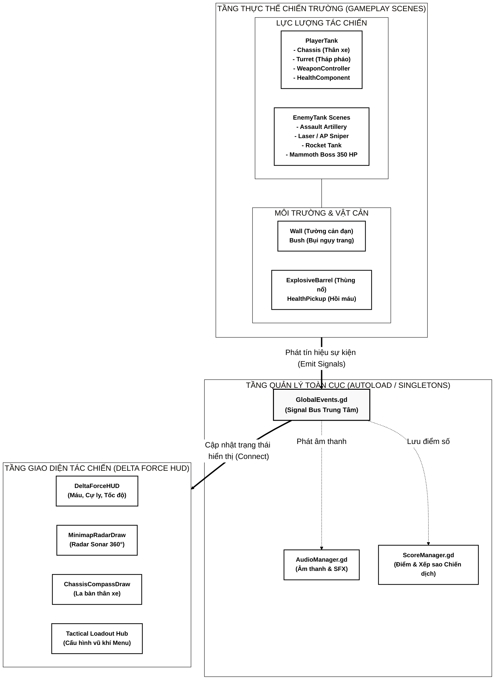
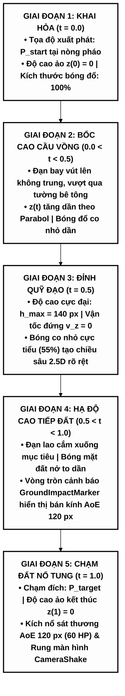
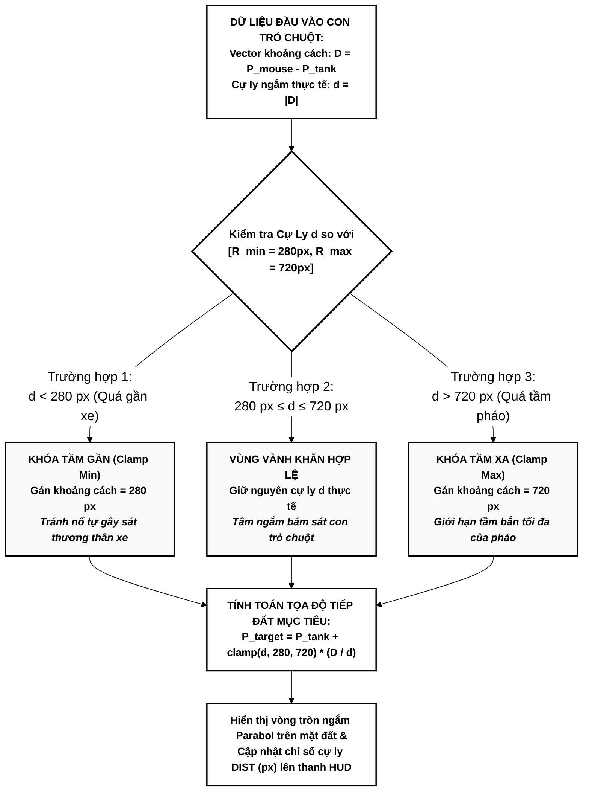
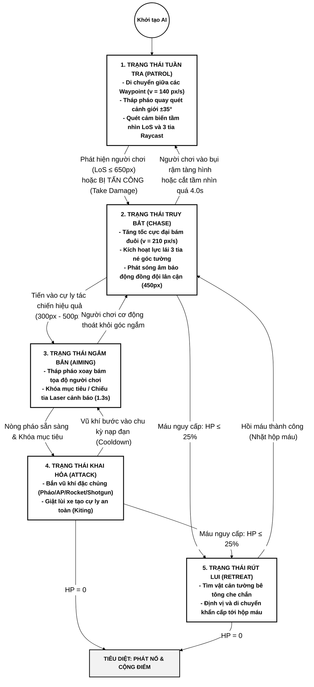
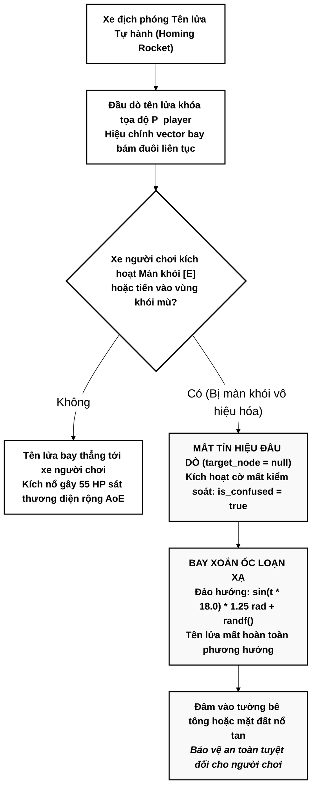

# BÁO CÁO ĐỒ ÁN TỐT NGHIỆP CÔNG NGHỆ THÔNG TIN

---

### TRƯỜNG ĐẠI HỌC KINH DOANH VÀ CÔNG NGHỆ HÀ NỘI
### KHOA CÔNG NGHỆ THÔNG TIN
### HỆ THỐNG ĐÀO TẠO & NGHIÊN CỨU MTA

---

<br><br>

# BÁO CÁO ĐỒ ÁN TỐT NGHIỆP

## ĐỀ TÀI:
# NGHIÊN CỨU CÔNG NGHỆ GAME ENGINE VÀ PHÁT TRIỂN GAME CHIẾN THUẬT PHÁO BINH 2.5D
## (DỰ ÁN: TANK ARTILLERY ARENA)

<br><br>

**Sinh viên thực hiện:** Trịnh Bá Chiến  
**Mã số sinh viên:** 2924110934  
**Lớp:** TH29.11  
**Chuyên ngành:** Kỹ thuật Phần mềm & Môi trường Ảo  

**Giảng viên hướng dẫn:** ThS. Lê Đức Huy  

<br><br>

---
### HÀ NỘI - NĂM 2026
---

<div style="page-break-after: always;"></div>


## LỜI CẢM ƠN

Trong quá trình học tập và hoàn thành đồ án tốt nghiệp, em đã nhận được sự dạy bảo và giúp đỡ tận tình từ quý thầy cô và bạn bè.

Trước hết, em xin gửi lời cảm ơn chân thành và sâu sắc nhất đến thầy **ThS. Lê Đức Huy** – người đã trực tiếp hướng dẫn, tận tình chỉ bảo và hỗ trợ em trong suốt quá trình thực hiện đề tài.

Em cũng xin gửi lời cảm ơn đến toàn thể quý thầy cô trong Khoa Công nghệ Thông tin – Trường Đại học Kinh doanh và Công nghệ Hà Nội đã truyền đạt kiến thức quý báu cho em trong những năm học vừa qua.

Do thời gian và kiến thức bản thân còn hạn chế, đồ án khó tránh khỏi những thiếu sót. Em rất mong nhận được những nhận xét, góp ý của quý thầy cô để đề tài được hoàn thiện hơn.

Em xin chân thành cảm ơn!

*Hà Nội, năm 2026*  
*Sinh viên thực hiện*  
**Trịnh Bá Chiến**

<div style="page-break-after: always;"></div>

## DANH MỤC CÁC TỪ VIẾT TẮT

| Từ viết tắt | Thuật ngữ tiếng Anh đầy đủ | Ý nghĩa tiếng Việt |
| :--- | :--- | :--- |
| **AoE** | Area of Effect | Vùng tác động / Sát thương diện rộng của đạn pháo |
| **AI** | Artificial Intelligence | Trí tuệ nhân tạo điều khiển các đơn vị xe tăng địch |
| **AP** | Armor-Piercing | Đạn xuyên giáp sơ tốc cao công phá công sự |
| **FSM** | Finite State Machine | Máy trạng thái hữu hạn điều khiển hành vi tác chiến của AI |
| **FoW** | Fog of War | Sương mù chiến tranh che khuất mục tiêu sau chướng ngại vật |
| **HUD** | Heads-Up Display | Giao diện hiển thị trạng thái tác chiến trực tiếp trên màn hình |
| **KPH** | Kilometers Per Hour | Đơn vị đo vận tốc hiển thị trên bảng đồng hồ tác chiến |
| **LoS** | Line of Sight | Đường ngắm thẳng / Tầm nhìn trực tiếp không bị vật cản che khuất |
| **MSAA** | Multi-Sample Anti-Aliasing | Kỹ thuật khử răng cưa đa mẫu làm mịn đường biên đồ họa |
| **PCK** | Package Archive File | Gói nhị phân nén đóng gói tài nguyên trò chơi độc lập của Godot |
| **UI/UX** | User Interface / User Experience | Giao diện người dùng / Trải nghiệm tác chiến người chơi |
| **VFX / SFX**| Visual Effects / Sound Effects | Hiệu ứng hình ảnh kỹ xảo / Hiệu ứng âm thanh chiến trường |

<div style="page-break-after: always;"></div>

## DANH MỤC HÌNH ẢNH

- **Hình 2.1:** Sơ đồ Kiến trúc Phân tầng Thực thể - Thành phần (Scene-Node & Component Architecture)
- **Hình 2.2:** Mô hình Quỹ đạo Đạn Parabola 2.5D và Tính toán Độ cao ảo $z(t)$
- **Hình 2.3:** Sơ đồ Không gian Ngắm bắn Giới hạn Vành khăn (Annulus Aim Clamp)
- **Hình 2.4:** Mô hình Máy trạng thái Hữu hạn (AI Finite State Machine) của Xe tăng Địch
- **Hình 3.1:** Mô hình Thân xe Độc lập với Tháp pháo và Chỉ báo Hướng Di chuyển Neon Chevrons
- **Hình 3.2:** Bố cục Cửa sổ Tùy chỉnh Hỏa lực Chiến Tăng (Tactical Loadout Modal) tại Menu
- **Hình 3.3:** Cơ chế Súng máy Tăng tốc (Spool-Up) và Hệ thống Quá nhiệt Nòng súng (Burn Out)
- **Hình 3.4:** Cơ chế Màn khói Tác chiến Điện tử làm Mất Khóa và Bay Loạn Xạ của Tên lửa Đuổi
- **Hình 3.5:** Bố cục Giao diện Quân sự Tối giản (Delta Force HUD) và Hệ thống Camera Zoom
- **Hình 4.1:** Bản đồ Chiến thuật 10 Màn chơi Chiến dịch và Phòng tập Tác chiến Sandbox
- **Hình 4.2:** Giao diện Menu Chính và Cửa sổ Lựa chọn Trang bị Hỏa lực
- **Hình 4.3:** Trận địa Mở rộng với Góc nhìn Camera Zoom $0.65$ và Minimap Radar $360^\circ$
- **Hình 4.4:** Đại chiến Siêu Xe Tăng Trùm Cuối Mammoth Boss tại Màn 10
- **Hình 4.5:** Màn hình Chiến thắng Tổng kết Thời gian, Điểm số và Vinh danh 5 Sao Max Cấp

---

## DANH MỤC BẢNG BIỂU

- **Bảng 2.1:** Danh mục Tín hiệu Tương tác Toàn cục trong `GlobalEvents.gd`
- **Bảng 3.1:** Bảng Đặc tả Kỹ thuật Hệ thống Hỏa lực Chính và Hỏa lực Phụ của Xe Tăng
- **Bảng 3.2:** Bảng Thông số Kỹ thuật Đa dạng hóa 7 Chủng loại Xe Tăng Địch và Trùm Cuối
- **Bảng 4.1:** Bảng Phân tích Đặc tả Địa hình và Thử thách Chiến thuật của 10 Màn chơi
- **Bảng 4.2:** Thang đo Đánh giá Xếp hạng Sao Chiến Dịch Dựa trên Thời gian Hoàn Thành
- **Bảng 5.1:** Bảng Tổng kết Thành quả 5 Trụ cột Công nghệ của Đồ án

<div style="page-break-after: always;"></div>

## MỤC LỤC CHI TIẾT

- **DANH MỤC CÁC TỪ VIẾT TẮT**
- **DANH MỤC HÌNH ẢNH & SƠ ĐỒ**
- **DANH MỤC BẢNG BIỂU**
- **LỜI MỞ ĐẦU**
  - 1. Lý do chọn đề tài
  - 2. Mục tiêu nghiên cứu
  - 3. Đối tượng và phạm vi nghiên cứu
  - 4. Bố cục của báo cáo
- **CHƯƠNG 1: TỔNG QUAN VỀ ĐỀ TÀI VÀ CÔNG NGHỆ NỀN TẢNG**
  - 1.1. Khởi nguồn ý tưởng và Cảm hứng phát triển
  - 1.2. Khảo sát các sản phẩm tương tự và định hình hướng tiếp cận
  - 1.3. Tổng quan về Nền tảng Công nghệ Godot Engine 4 & GDScript 2.0
  - 1.4. Kết luận chương 1
- **CHƯƠNG 2: KIẾN TRÚC HỆ THỐNG VÀ CƠ SỞ LÝ THUYẾT / THUẬT TOÁN CỐT LÕI**
  - 2.1. Kiến trúc tổng thể Scene-Node và Mô hình Event-Driven Decoupled
  - 2.2. Các đặc trưng kỹ thuật cốt lõi và Chiến lược Tối ưu hóa Hiệu năng
  - 2.3. Cơ sở lý thuyết và các giải thuật chuyên sâu
    - 2.3.1. Giải thuật Mô phỏng Đạn Đạo Parabola 2.5D và Điểm rơi AoE
    - 2.3.2. Giải thuật Khóa Phạm vi Ngắm Vành khăn (Annulus Aim Clamp)
    - 2.3.3. Giải thuật Sương mù Chiến tranh (Fog of War) và Tầm nhìn Trực tiếp (Line of Sight)
    - 2.3.4. Mô hình Trí tuệ Nhân tạo Xe tăng Địch (AI Finite State Machine & Steering Behaviors)
  - 2.4. Kết luận chương 2
- **CHƯƠNG 3: THIẾT KẾ VÀ CÀI ĐẶT CÁC PHÂN HỆ CHỨC NĂNG CỦA DỰ ÁN**
  - 3.1. Phân hệ Thân xe, Vật lý Di chuyển và Chỉ báo Hướng Tác chiến Neon
  - 3.2. Phân hệ Vũ khí Đa tầng & Quản trị Cấu hình Trang bị tại Menu
  - 3.3. Phân hệ Trí tuệ Nhân tạo Kẻ địch Đa dạng và Trùm Cuối Mammoth
  - 3.4. Phân hệ Môi trường Tác chiến, Địa hình Chiến thuật và Bụi rậm Phục kích
  - 3.5. Phân hệ Tối ưu Góc nhìn Bản đồ Rộng và Giao diện Quân sự Tinh giản (Delta Force HUD)
  - 3.6. Kết luận chương 3
- **CHƯƠNG 4: TRIỂN KHAI THỰC THI, THỰC NGHIỆM VÀ ĐÁNH GIÁ KẾT QUẢ**
  - 4.1. Cấu trúc 10 Màn chơi Chiến dịch và Chế độ Phòng tập Tác chiến Sandbox
  - 4.2. Kịch bản thực nghiệm từng bước với giao diện thực tế (Bước 1 $\to$ Bước 10)
  - 4.3. Hệ thống Tính điểm Theo Thời gian và Xếp hạng 5 Sao Max Cấp
  - 4.4. Đánh giá Kiểm thử và Cân bằng Hệ thống
  - 4.5. Đánh giá Thuận lợi và Khó khăn trong Quá trình Phát triển
  - 4.6. Kết luận chương 4
- **TỔNG KẾT VÀ HƯỚNG PHÁT TRIỂN**
  - 1. Tổng kết những kết quả đạt được (5 trụ cột công nghệ)
  - 2. Hướng phát triển trong tương lai
- **KẾT LUẬN ĐỀ TÀI**
- **TÀI LIỆU THAM KHẢO**
- **PHỤ LỤC: TOÀN BỘ DANH MỤC CÂY THƯ MỤC VÀ TỆP TIN DỰ ÁN**

<div style="page-break-after: always;"></div>

# LỜI MỞ ĐẦU

### 1. Lý do chọn đề tài
Trong kỷ nguyên phát triển mạnh mẽ của công nghiệp phần mềm giải trí và đồ họa máy tính, dòng game chiến thuật thời gian thực và mô phỏng quân sự luôn giữ vị trí then chốt nhờ đòi hỏi tư duy chiến thuật sâu sắc, khả năng phản xạ nhanh và sự phối hợp giữa tính toán vật lý với kiểm soát không gian. Các tựa game bắn xe tăng truyền thống góc nhìn từ trên xuống (Top-down 2D kinh điển như *Battle City*) thường sở hữu lối chơi đơn giản: xe tăng chỉ bắn các viên đạn đi thẳng trên mặt phẳng, không có chiều sâu không gian, không có cơ chế phân tầng hỏa lực và thiếu sự đa dạng về mặt địa hình.

Nhằm đưa trải nghiệm mô phỏng chiến đấu xe tăng lên tầm cao mới, đề tài **"Nghiên cứu công nghệ Game Engine và Phát triển Game Chiến thuật Pháo binh 2.5D (Dự án: Tank Artillery Arena)"** được lựa chọn nghiên cứu và triển khai. Đề tài tập trung vào việc mô phỏng thực tế chiến thuật hỏa lực phân tầng: kết hợp giữa **Pháo cối tầm xa bắn cầu vồng Parabola** vượt chướng ngại vật với **Hỏa lực phụ cận chiến trực xạ** (Súng xuyên giáp AP, Súng máy tăng tốc quá nhiệt, Súng shotgun tán xạ), đặt trong môi trường tác chiến hiện đại có sương mù chiến tranh (Fog of War), cơ chế bụi cây ngụy trang, màn khói mù tác chiến điện tử và hệ thống radar quét $360^\circ$.

### 2. Mục tiêu nghiên cứu
1. **Làm chủ nền tảng Godot Engine 4:** Nghiên cứu kiến trúc phân tầng Scene-Node, mô hình Event-Driven Decoupled thông qua Signal Bus toàn cục, và ngôn ngữ định kiểu GDScript 2.0.
2. **Mô hình hóa đạn đạo Parabola 2.5D:** Xây dựng giải thuật toán học tính toán quỹ đạo parabol, độ cao ảo $z(t)$, bóng đổ mặt đất động, hiển thị cảnh báo vùng nổ diện rộng (AoE $120\text{ px}$) và giới hạn tầm bắn theo vành khăn $[R_{min}, R_{max}]$.
3. **Thiết kế Trí tuệ Nhân tạo AI Chiến thuật Đa Chế độ:** Hiện thực hóa máy trạng thái hữu hạn (FSM) và hành vi né tránh chướng ngại vật cho 7 chủng loại xe tăng địch với vũ khí chuyên biệt cùng Siêu Trùm Cuối Mammoth Boss.
4. **Xây dựng Giao diện Tác chiến Quân sự Chuẩn Delta Force:** Tối ưu góc nhìn camera zoom linh hoạt, tinh giản triệt để HUD nhằm giải phóng $100\%$ không gian ngắm bắn chính giữa, cung cấp Radar Sonar 360°, la bàn xe tăng và chỉ báo hướng thân xe neon.
5. **Hoàn thiện Chuỗi 10 Màn chơi Chiến dịch & Hệ thống Đánh giá 5 Sao Max Cấp:** Thiết kế kịch bản thử thách tăng dần, tích hợp hệ thống đo lường thời gian, tính điểm tốc độ và lưu trữ kỷ lục bền vững vào tập tin cấu hình.

### 3. Đối tượng và phạm vi nghiên cứu
- **Đối tượng nghiên cứu:** Nền tảng Godot Engine v4.7.2 Stable (x86_64), ngôn ngữ lập trình GDScript 2.0, mô hình vật lý `CharacterBody2D`, thư viện toán học vector 2D, shader đồ họa và hệ thống hiệu ứng hạt `CPUParticles2D`.
- **Phạm vi nghiên cứu:** Ứng dụng Desktop chạy độc lập trên hệ điều hành Windows, bao gồm 10 màn chơi chiến dịch độc lập, chế độ phòng tập Sandbox, hệ thống quản lý vũ khí tại Menu chính và cơ chế đóng gói độc lập dạng file nhị phân `.pck`.

### 4. Bố cục của báo cáo
Nội dung báo cáo được cấu trúc chặt chẽ thành 4 chương chính:
- **Chương 1:** Tổng quan về đề tài và công nghệ nền tảng.
- **Chương 2:** Kiến trúc hệ thống và cơ sở lý thuyết / thuật toán cốt lõi.
- **Chương 3:** Thiết kế và cài đặt các phân hệ chức năng của dự án.
- **Chương 4:** Triển khai thực thi, thực nghiệm và đánh giá kết quả.
- **Tổng kết, Hướng phát triển, Kết luận đề tài, Tài liệu tham khảo và Phụ lục.**

<div style="page-break-after: always;"></div>

# CHƯƠNG 1: TỔNG QUAN VỀ ĐỀ TÀI VÀ CÔNG NGHỆ NỀN TẢNG

## 1.1. Khởi nguồn ý tưởng và Cảm hứng phát triển

Ký ức về những cỗ xe tăng pixel bốn nút trong tựa game huyền thoại *Battle City (1990)* từng là một phần tuổi thơ không thể nào quên của biết bao thế hệ yêu thích trò chơi điện tử. Thế nhưng, đã qua rồi thời kỳ mà trải nghiệm chiến đấu xe tăng chỉ dừng lại ở những khối vuông di chuyển gò bó trên mặt phẳng hai chiều, bắn ra những viên đạn thẳng tắp và chịu khuất phục trước những bức tường gạch đơn điệu.

Thế giới game và công nghệ mô phỏng hiện đại mở ra những không gian sáng tạo vô tận. Tại sao một chiến xa không thể sở hữu hệ thống thân xe cơ động độc lập với tháp pháo tác chiến? Tại sao người chơi không được trải nghiệm cảm giác tính toán cự ly, phóng ra những phát đạn pháo cối xé gió bay vút lên không trung, vượt qua mọi chướng ngại vật rồi dội bão lửa xuống trận địa theo quỹ đạo Parabol 2.5D sống động? Và hơn hết, một chiến trường xe tăng đích thực sẽ kịch tính đến nhường nào nếu người chơi phải đối mặt với sương mù chiến tranh che khuất tầm nhìn, khéo léo ẩn mình trong những bụi rậm rình rập, hay kích hoạt màn khói mù tác chiến điện tử làm nhiễu loạn cả những quả tên lửa tự hành bám đuôi?

Chính niềm đam mê với dòng game chiến thuật quân sự cùng khao khát vượt qua khuôn mẫu của các trò chơi bắn tăng cổ điển đã khơi nguồn cảm hứng cho sự ra đời của **Tank Artillery Arena**. Đề tài được xây dựng như một đấu trường thiết giáp thời gian thực giàu chiều sâu, kết hợp hài hòa giữa tư duy tính toán đạn đạo gián tiếp với kỹ năng sinh tồn tốc độ cao. Đây không chỉ là hành trình giải quyết các bài toán kỹ thuật công nghệ đồ họa và thuật toán trên Game Engine hiện đại, mà còn là nỗ lực tạo nên một sản phẩm trò chơi giàu cảm xúc, đưa người chơi bước vào một chiến trường pháo binh đầy hào hứng và chân thực.

## 1.2. Khảo sát các sản phẩm tương tự và định hình hướng tiếp cận

| Tiêu chí so sánh | Battle City (NES Cổ điển) | Scorched Earth / Worms | World of Tanks Blitz | Tank Artillery Arena (Đề tài) |
| :--- | :--- | :--- | :--- | :--- |
| **Góc nhìn** | Top-down 2D cố định | Mặt cắt ngang 2D (Side-scrolling) | 3D Góc nhìn người thứ ba | **Top-down 2.5D Động (Camera Zoom linh hoạt)** |
| **Cơ chế đường đạn** | Đạn bay thẳng 1 chiều | Đạn cầu vồng theo lượt | Đạn bay thẳng 3D | **Parabola 2.5D thời gian thực + Đạn trực xạ kết hợp** |
| **Phân tầng hỏa lực** | 1 loại đạn duy nhất | Chọn vũ khí theo lượt | 1 nòng pháo chính | **Hỏa lực kép: Chuột trái (Pháo cối/AP/Rocket) + Chuột phải (AP xuyên thấu/Súng máy/Shotgun)** |
| **Môi trường & Trinh sát** | Tường gạch/thép cố định | Địa hình phá hủy biến dạng | Bụi rậm ngụy trang 3D | **Sương mù chiến tranh FoW, Bụi rậm ẩn thân, Khói mù tác chiến điện tử, Thùng nổ dây chuyền** |
| **Giao diện tác chiến** | Chỉ số điểm số đơn giản | Bảng tọa độ góc/lực | Giao diện HUD 3D | **Delta Force HUD: Minimap Radar 360°, la bàn xe tăng, chỉ báo neon, phím [H] ẩn HUD** |

*Bảng 1.1: So sánh đặc trưng kỹ thuật giữa Tank Artillery Arena và các sản phẩm tương tự*

## 1.3. Tổng quan về Nền tảng Công nghệ Godot Engine 4 & GDScript 2.0
Dự án được xây dựng trên nền tảng **Godot Engine v4.7.2 Stable (Windows x86_64)**, một trong những Game Engine mã nguồn mở hiện đại hàng đầu với các ưu thế kỹ thuật:
1. **Kiến trúc Scene-Node thuần nhất:** Mọi thực thể (xe tăng, viên đạn, chướng ngại vật, giao diện UI) đều là một Node nằm trong Cây khung cảnh (Scene Tree). Tính năng lồng ghép cảnh (Scene Instancing) cho phép tái sử dụng module ở mức độ tuyệt đối.
2. **Ngôn ngữ GDScript 2.0 Định kiểu Tĩnh (Static Typing):** Tích hợp sâu vào nhân C++ của engine, hỗ trợ cú pháp tường minh (`var speed: float = 180.0`), tối ưu hóa bộ nhớ, phát hiện lỗi biên dịch tĩnh (Compile-time checking) và tăng tốc độ thực thi vật lý.
3. **Hệ thống Vật lý 2D Chuyên dụng:** Node `CharacterBody2D` cung cấp phương thức `move_and_slide()` và `move_and_collide()`, tự động xử lý trượt ma sát khi va chạm góc nghiêng, ngăn ngừa hoàn toàn hiện tượng xuyên thấu vật thể (tunneling effect).
4. **Bộ kết xuất Tương thích (Renderer Compatibility):** Sử dụng chuẩn đồ họa OpenGL / WebGL hiện đại, đảm bảo tốc độ khung hình ổn định $60\text{ FPS}$ ngay cả trên các thiết bị phần cứng phổ thông.

## 1.4. Kết luận chương 1
Việc lựa chọn Godot Engine 4 cùng hướng tiếp cận game chiến thuật pháo binh 2.5D phân tầng hỏa lực là nền tảng công nghệ vững chắc, đáp ứng trọn vẹn các yêu cầu về hiệu năng, tính mở rộng và trải nghiệm người dùng trong đồ án.

<div style="page-break-after: always;"></div>

# CHƯƠNG 2: KIẾN TRÚC HỆ THỐNG VÀ CƠ SỞ LÝ THUYẾT / THUẬT TOÁN CỐT LÕI

## 2.1. Kiến trúc tổng thể Scene-Node và Mô hình Event-Driven Decoupled
Kiến trúc phần mềm của trò chơi được thiết kế theo mô hình **Hướng sự kiện Giảm ghép nối (Event-Driven Decoupled Architecture)** kết hợp cấu trúc Thành phần (Entity-Component System).


*Hình 2.1: Sơ đồ kiến trúc tổng thể phân tầng của hệ thống Tank Artillery Arena*

### Bảng tín hiệu toàn cục trong `GlobalEvents.gd`
| Tên Signal | Tham số truyền vào | Chức năng hệ thống |
| :--- | :--- | :--- |
| `bullet_fired` | `bullet_type: String, pos: Vector2` | Thông báo vũ khí khai hỏa, kích hoạt âm thanh và chớp sáng |
| `artillery_impact` | `pos: Vector2, radius: float` | Kích hoạt hiệu ứng nổ pháo diện rộng và rung màn hình |
| `camera_shake_requested` | `intensity: float, duration: float` | Yêu cầu `CameraShake.gd` rung màn hình theo xung chấn |
| `tank_damaged` | `tank_node: Node2D, amount: int` | Cập nhật thanh máu nổi và giao diện HUD |
| `tank_destroyed` | `tank_node: Node2D, is_player: bool` | Kích hoạt hiệu ứng nổ tan mảnh xác xe và cộng điểm chiến tích |
| `radar_ping_requested` | `origin: Vector2, radius: float` | Kích hoạt sóng siêu âm Sonar quét lộ diện xe địch qua tường |

*Bảng 2.1: Danh mục tín hiệu tương tác toàn cục trong `GlobalEvents.gd`*

---

## 2.2. Các đặc trưng kỹ thuật cốt lõi và Chiến lược Tối ưu hóa Hiệu năng
1. **Nguyên lý Tách biệt Mối quan tâm (Separation of Concerns):**
   - Thân xe (`TankChassis.gd`) chỉ chịu trách nhiệm điều khiển quán tính bánh xích và góc xoay thân.
   - Tháp pháo (`TurretAim.gd`) độc lập tính toán góc xoay theo chuột và giới hạn cự ly ngắm vành khăn.
   - Bộ điều khiển vũ khí (`WeaponController.gd`) quản lý độc lập tiến trình nạp đạn, quá nhiệt và chủng loại đạn.
   - Khối sinh lực (`HealthComponent.gd`) là thành phần dùng chung cho cả xe người chơi, xe địch và công sự phá hủy được.
2. **Chiến lược Quản lý Vòng đời Tài nguyên (Object Lifecycle & Memory Management):**
   - Mọi thực thể đạn (`ArtilleryShell`, `HeavyAPBullet`, `HomingRocket`, `MachineGunBullet`) đều có bộ đếm thời gian tự hủy (`queue_free()`) sau khi chạm mục tiêu hoặc vượt quá thời gian bay an toàn, ngăn ngừa tuyệt đối rò rỉ bộ nhớ (Memory Leak).
   - Âm thanh được quản lý bởi danh sách phát động (Dynamic Audio Stream Players Pool) trong `AudioManager.gd`.
3. **Khử răng cưa và Tối ưu hóa Đồ họa 2D:**
   - Kích hoạt cơ chế MSAA 2D kết hợp Texture Filter dạng Mipmap tuyến tính trong `project.godot`, đảm bảo các đường biên xe tăng và vệt đạn neon sắc nét ở mọi độ thu phóng camera.

---

## 2.3. Cơ sở lý thuyết và các giải thuật chuyên sâu

### 2.3.1. Giải thuật Mô phỏng Đạn Đạo Parabola 2.5D và Điểm rơi AoE
Trong góc nhìn Top-down 2D, người chơi nhìn từ trên cao xuống mặt phẳng $(x, y)$. Để mô phỏng đạn pháo cối bay vút lên cao rồi cắm xuống đất theo quỹ đạo cầu vồng, hệ thống xây dựng mô hình toán học độ cao ảo $z(t)$ theo thời gian chuẩn hóa $t \in [0, 1]$.


*Hình 2.2: Mô hình tiến trình quỹ đạo đạn Parabol 2.5D và độ cao ảo $z(t)$*

- **Công thức tính toán tọa độ mặt phẳng:**
  $$\vec{P}_{ground}(t) = \vec{P}_{start} + t \cdot (\vec{P}_{target} - \vec{P}_{start})$$
- **Công thức độ cao ảo $z(t)$ mô phỏng ném xiên không trọng lực giả:**
  $$z(t) = 4 \cdot h_{max} \cdot t \cdot (1 - t)$$
  Trong đó: $h_{max}$ là độ cao cực đại tại đỉnh đường đạn ($h_{max} = 140\text{ px}$).
- **Tọa độ hiển thị viên đạn trên màn hình (`Render Position`):**
  $$\vec{P}_{render}(t) = \vec{P}_{ground}(t) - \begin{pmatrix} 0 \\ z(t) \end{pmatrix}$$
- **Tọa độ bóng đổ mặt đất (`Shadow Position`):** Giữ nguyên tại $\vec{P}_{ground}(t)$. Kích thước bóng đổ co giãn theo độ cao:
  $$\text{Scale}_{shadow}(t) = 1.0 - 0.45 \cdot \frac{z(t)}{h_{max}}$$
- **Vùng cảnh báo điểm rơi AoE (`GroundImpactMarker`):**
  Tại điểm rơi mục tiêu $\vec{P}_{target}$, hệ thống vẽ một vòng tròn cảnh báo màu cam bán kính $R_{AoE} = 120\text{ px}$ kèm thanh đếm ngược thời gian tiếp đất, giúp người chơi và xe địch có thể quan sát để phản xạ né tránh.

---

### 2.3.2. Giải thuật Khóa Phạm vi Ngắm Vành khăn (Annulus Aim Clamp)
Pháo cối có góc nâng giới hạn: không thể bắn quá gần thân xe (nguy cơ tự sát) và không thể bắn xa vô hạn. Cự ly ngắm hợp lệ nằm trong vành khăn $[R_{min}, R_{max}] = [280\text{ px}, 720\text{ px}]$.

$$\vec{D} = \vec{P}_{mouse} - \vec{P}_{tank}, \quad d = |\vec{D}|$$
$$\vec{P}_{target} = \vec{P}_{tank} + \text{clamp}(d, R_{min}, R_{max}) \cdot \frac{\vec{D}}{d}$$


*Hình 2.3: Sơ đồ thuật toán khóa cự ly ngắm bắn theo không gian vành khăn (Annulus Aim Clamp)*

---

### 2.3.3. Giải thuật Sương mù Chiến tranh (Fog of War) và Tầm nhìn Trực tiếp (Line of Sight)
Hệ thống sử dụng tia Raycast2D kết hợp mặt nạ va chạm va chạm tường `CollisionMask = 2` để xác định trạng thái hiển thị của kẻ địch:
1. **Điều kiện Nhìn thấy Trực tiếp (Direct Line of Sight):**
   Bắn tia từ vị trí người chơi $\vec{P}_{player}$ đến tâm xe địch $\vec{P}_{enemy}$. Nếu không có va chạm tường bê tông và khoảng cách $d \le 650\text{ px}$, xe địch hiển thị sáng rõ.
2. **Cảm biến Âm thanh Áp sát (Proximity Detection):**
   Trong cự ly gần $d \le 160\text{ px}$, tiếng động cơ xe tăng đủ lớn để định vị mục tiêu ngay cả khi bị tường mỏng che khuất.
3. **Cờ Phát Hỏa (Gunfire Flare Reveal):**
   Khi một xe địch nổ súng từ trong góc khuất hoặc bụi cây, cờ `is_revealed_by_gunfire` lập tức được kích hoạt trong thời gian $2.5\text{ s}$, hiển thị vị trí trên màn hình và radar.

---

### 2.3.4. Mô hình Trí tuệ Nhân tạo Xe tăng Địch (AI Finite State Machine & Steering Behaviors)
Hệ thống AI được cài đặt dưới dạng Máy trạng thái Hữu hạn (FSM) gồm 5 trạng thái tác chiến linh hoạt:


*Hình 2.4: Mô hình máy trạng thái hữu hạn (AI Finite State Machine) điều khiển hành vi xe tăng địch*

- **Lực Lái Tránh Né Chướng Ngại Vật (Obstacle Avoidance Steering):** Xe tăng AI sử dụng 3 tia dò (tia chính giữa $80\text{ px}$, 2 tia góc lệch $\pm 30^\circ$) để phát hiện góc tường và tự động sinh lực lái góc vuông giúp xe không bao giờ bị kẹt vào vật cản.

## 2.4. Kết luận chương 2
Mô hình kiến trúc phân tầng Scene-Node kết hợp các giải thuật toán học đường đạn Parabola 2.5D, khóa ngắm vành khăn và máy trạng thái FSM đã tạo nên khung xương kỹ thuật vững chắc, đảm bảo tính chân thực và hiệu năng cao cho toàn bộ hệ thống.

<div style="page-break-after: always;"></div>

# CHƯƠNG 3: THIẾT KẾ VÀ CÀI ĐẶT CÁC PHÂN HỆ CHỨC NĂNG CỦA DỰ ÁN

## 3.1. Phân hệ Thân xe, Vật lý Di chuyển và Chỉ báo Hướng Tác chiến Neon

### 3.1.1. Đặc tả yêu cầu chức năng
1. Xe tăng di chuyển theo mô hình vật lý xe bánh xích: các phím W/S điều khiển tiến/lùi theo trục dọc của thân xe, các phím A/D điều khiển xoay thân xe tại chỗ hoặc khi đang chạy.
2. Tháp pháo quay tự do $360^\circ$ độc lập theo con trỏ chuột.
3. Cung cấp chỉ báo thị giác rõ ràng về hướng tiến của thân xe để người chơi luôn nắm bắt được phương hướng di chuyển ngay cả khi đang xoay tháp pháo ngắm bắn ở góc lệch $90^\circ$ hoặc $180^\circ$.
4. Thân xe hiển thị sắc nét, sáng rõ, tách bạch hoàn toàn với mặt đất và các hiệu ứng giao diện.

### 3.1.2. Thiết kế kiến trúc và Nguyên lý hoạt động
- **Phân tách tầng hiển thị (Z-Index Hierarchy):** Thân xe `ChassisSprite` được gán `z_index = 2`, tháp pháo `TurretSprite` gán `z_index = 4`, đèn pha và bóng đổ mặt đất gán `z_index = 0`. Thân xe được áp dụng hiệu ứng cân chỉnh màu sắc tương phản cao (`modulate = Color(1.18, 1.15, 1.08, 1.0)`), làm nổi bật chi tiết kim loại và xích xe.
- **Chỉ báo Hướng Tiến 3 Mũi Tên Chevrons Neon (`ChassisForwardIndicator.gd`):** Hệ thống sử dụng lệnh đồ họa vector nguyên thủy `draw_line()` vẽ 3 mũi tên Chevrons màu xanh Cyan nhấp nhô tuần hoàn theo hàm sóng sin thời gian ở phía trước mũi xe, chỉ rõ ràng hướng tiến mà không che khuất thân xe.
- **La bàn Thân xe Quân sự (`ChassisCompassDraw.gd`):** Hiển thị góc quay thực tế của thân xe so với phương Bắc bản đồ ngay trên giao diện HUD.

<div align="center">


*Hình 3.1: Mô hình Thân xe Độc lập với Tháp pháo và Chỉ báo Hướng Di chuyển Neon Chevrons*
</div>

### 3.1.3. Cài đặt mã nguồn tiêu biểu
```gdscript
# ChassisForwardIndicator.gd - Chỉ báo 3 mũi tên Chevrons neon động phía trước thân xe
extends Node2D

@export var arrow_color: Color = Color(0.2, 0.9, 1.0, 0.9)
var pulse_time: float = 0.0

func _process(delta: float) -> void:
    pulse_time += delta * 4.0
    queue_redraw()

func _draw() -> void:
    # Vẽ 3 mũi tên Chevrons neon nhấp nhô tuần hoàn
    for i in range(3):
        var offset := 52.0 + i * 16.0 + sin(pulse_time - i * 0.8) * 3.0
        var alpha := clampf(1.0 - i * 0.28, 0.1, 1.0)
        var col := Color(arrow_color.r, arrow_color.g, arrow_color.b, arrow_color.a * alpha)
        var tip := Vector2(offset + 10.0, 0)
        var left := Vector2(offset - 6.0, -10.0)
        var right := Vector2(offset - 6.0, 10.0)
        draw_line(left, tip, col, 2.5, true)
        draw_line(right, tip, col, 2.5, true)
```

---

## 3.2. Phân hệ Vũ khí Đa tầng & Quản trị Cấu hình Trang bị tại Menu

### 3.2.1. Đặc tả yêu cầu chức năng
1. Hỏa lực xe tăng được phân tầng thành 2 nhóm độc lập:
   - **Hỏa lực Chính (Chuột trái):** Vũ khí công kích tầm xa chủ lực.
   - **Hỏa lực Phụ (Chuột phải):** Vũ khí tự vệ và đột phá cận chiến/tầm trung.
2. Để nâng cao tính kỷ luật chiến thuật, cấu hình vũ khí được khóa cố định trong trận đấu; người chơi phải nghiên cứu địa hình từng màn và thiết lập cấu hình trang bị (Weapon Loadout) tại Menu chính trước khi xuất kích.
3. Cung cấp 3 loại vũ khí phụ chuột phải chuyên biệt: Đạn xuyên giáp AP siêu sát thương xuyên thấu, Súng máy tăng tốc quá nhiệt, và Súng Shotgun tán xạ.

### 3.2.2. Thiết kế kiến trúc các loại vũ khí

| Chủng loại vũ khí | Vị trí kích hoạt | Sát thương | Thời gian nạp / Chu kỳ bắn | Cơ chế đặc biệt |
| :--- | :---: | :---: | :---: | :--- |
| **Pháo cối Parabola (Mặc định)** | Chuột trái | 60 HP (AoE 120px) | 1.10 s | Đạn bay cầu vồng vượt tường, cảnh báo điểm rơi mặt đất |
| **Song pháo Trực xạ (Twin AP)** | Chuột trái | 20 HP x 2 viên | 0.55 s | Bắn loạt đạn kép sơ tốc cao 1100 px/s |
| **Tên lửa Tự hành (Homing Rocket)**| Chuột trái | 55 HP (AoE 90px) | 1.80 s | Khóa mục tiêu 1.5s, bay tự động lượn lách vượt tường |
| **Súng Xuyên Giáp AP (Heavy AP)** | **Chuột phải (Mặc định)** | **75 HP** | **0.70 s** | **Sơ tốc 1350 px/s, đục xuyên tối đa 3 xe địch / công sự** |
| **Súng Máy Tăng Tốc (Spool-Up MG)** | **Chuột phải** | **8 HP/viên** | **0.16s $\to$ 0.045s** | **Bắn nhanh dần khi giữ chuột, cơ chế quá nhiệt nòng súng** |
| **Súng Shotgun Tán Xạ (Scatter Gun)**| **Chuột phải** | **12 HP x 6 mảnh** | **0.82 s** | **Chùm 6 mảnh đạn góc 18°, tổng sát thương 72 HP cận chiến** |

*Bảng 3.1: Bảng đặc tả kỹ thuật hệ thống vũ khí phân tầng của xe tăng người chơi*

### 3.2.3. Cài đặt các cơ chế vũ khí độc quyền

#### A. Cơ chế Xuyên Thấu Đa Mục Tiêu của Đạn Xuyên Giáp AP (`HeavyAPBullet.gd`)
Đạn Heavy AP sở hữu động năng cực đại, khi trúng mục tiêu sẽ gây $75\text{ HP}$ sát thương và tiếp tục hành trình xuyên qua xe địch hoặc thùng gỗ, chỉ dừng lại khi chạm tường bê tông hoặc xuyên quá 3 thực thể:
```gdscript
# HeavyAPBullet.gd - Cơ chế đạn AP xuyên thấu đa mục tiêu
var max_pierce: int = 3
var current_pierce: int = 0
var hit_entities: Array[Node] = []

func _on_body_entered(body: Node2D) -> void:
    if body in hit_entities:
        return
    if body.is_in_group("enemies") or body.is_in_group("destructible"):
        hit_entities.append(body)
        current_pierce += 1
        if body.has_method("take_damage"):
            body.take_damage(damage, false)
        
        # Kiểm tra nếu còn số lần xuyên thấu thì tiếp tục bay
        if current_pierce >= max_pierce:
            explode()
    elif body is TileMap or body.is_in_group("walls"):
        explode() # Va chạm tường kiên cố thì nổ tan
```

#### B. Cơ chế Bắn Nhanh Dần (Spool-Up) và Quá Nhiệt Nòng Súng (`WeaponController.gd`)
Súng máy mô phỏng chính xác nòng súng xoay nhiều nòng (Gatling/Minigun). Khi giữ chuột phải, biến `mg_spool_progress` tăng dần từ $0.0 \to 1.0$, làm rút ngắn chu kỳ nạp từ $0.16\text{ s}$ xuống chỉ còn $0.045\text{ s}$ (tốc độ bắn tăng gấp 3.5 lần). Đồng thời, mỗi phát bắn tích tụ nhiệt lượng `mg_heat` ($+6.5\%$), khi đạt $100\%$ sẽ khóa nòng trong $2.8\text{ s}$ để hạ nhiệt.

```mermaid
%%{init: {'theme': 'base', 'themeVariables': { 'clusterBkg': '#ffffff', 'clusterBorder': '#000000', 'lineColor': '#000000', 'edgeLabelBackground':'#ffffff', 'primaryTextColor': '#000000', 'fontSize': '22px'}}}%%
flowchart LR
    classDef default fill:#ffffff,stroke:#000000,stroke-width:2px,color:#000000,font-size:18px,font-weight:bold;

    subgraph S_IDLE["1. TRẠNG THÁI NGHỈ (IDLE)"]
        direction TB
        I1["Nòng súng nguội: Heat = 0%"]
        I2["Tốc độ bắn ban đầu: 0.16s / viên"]
    end

    subgraph S_FIRE["2. GIỮ CHUỘT PHẢI: TĂNG TỐC (SPOOL-UP)"]
        direction TB
        F1["Nòng xoay tăng tốc: spool_progress -> 1.0"]
        F2["Tốc độ xả đạn cực đại: 0.045s / viên (x3.5)"]
        F3["Nhiệt lượng tích tụ: +6.5% / mỗi viên"]
    end

    subgraph S_OVERHEAT["3. ĐẠT 100% NHIỆT: QUÁ NHIỆT (BURN OUT)"]
        direction TB
        O1["Khóa nòng súng hoàn toàn trong 2.8s"]
        O2["Cảnh báo [OVERHEATED] nhấp nháy đỏ trên HUD"]
        O3["Không thể khai hỏa cho đến khi hạ nhiệt"]
    end

    subgraph S_COOL["4. HẠ NHIỆT TỰ NHIÊN (COOLDOWN)"]
        direction TB
        C1["Nhả chuột: Hạ nhiệt độ -35% / giây"]
        C2["Về trạng thái an toàn: Heat = 0%"]
    end

    S_IDLE -- "Nhấn giữ Chuột Phải" --> S_FIRE
    S_FIRE -- "Nhả chuột khi Heat &lt; 100%" --> S_COOL
    S_FIRE -- "Giữ bắn liên tục tới Heat = 100%" --> S_OVERHEAT
    S_OVERHEAT -- "Hết thời gian cưỡng chế 2.8s" --> S_IDLE
    S_COOL --> S_IDLE
```


*Hình 3.3: Sơ đồ chu trình cơ chế súng máy tăng tốc (Spool-Up) và hệ thống quá nhiệt nòng súng (Burn Out)*

#### C. Trung tâm Cấu hình Trang bị tại Menu (`MainMenu.gd`)
Giao diện Modal tùy chỉnh hỏa lực được thiết kế song song với 2 thẻ thông số độc lập (`PrimaryCard` và `SecondaryCard`). Cấu hình người chơi chọn được lưu tự động vào tập tin nhị phân chuẩn `user://weapon_loadout.cfg` và nạp vào trận chiến ngay khi bắt đầu màn chơi.

<div align="center">


*Hình 3.2: Bố cục Cửa sổ Tùy chỉnh Hỏa lực Chiến Tăng (Tactical Loadout Modal) tại Menu*
</div>

---

## 3.3. Phân hệ Trí tuệ Nhân tạo Kẻ địch Đa dạng và Trùm Cuối Mammoth

Hệ thống kẻ địch được đa dạng hóa toàn diện về cả loại vũ khí sử dụng, màu sắc nhận diện, vận tốc và cự ly tác chiến:

| Chủng loại xe địch | Lượng Máu (HP) | Vận tốc | Vũ khí trang bị | Màu sắc nhận diện | Đặc điểm chiến thuật |
| :--- | :---: | :---: | :--- | :--- | :--- |
| **Xe Đột Kích Shotgun (Shotgun Raider)** | 65 HP | 175 px/s | Súng Shotgun Tán xạ (5 mảnh) | Cam Cháy rực lửa | Cơ động cực cao, áp sát nhanh (<320 px) xả chùm mảnh đạn |
| **Xe Bắn Tỉa AP (Heavy AP Sniper)** | 85 HP | 110 px/s | Súng Xuyên Giáp AP (30 DMG) | Xanh Thép sẫm | Giữ cự ly tầm xa 520 px, bắn đạn xuyên giáp trực xạ chuẩn xác |
| **Xe Hỏa Lực Song Pháo (Twin Cannon)** | 90 HP | 125 px/s | Song pháo trực xạ kép (20 DMG x 2)| Vàng Đồng Sa mạc | Bắn loạt đạn kép dồn sát thương liên tục ở tầm trung |
| **Xe Tấn Công (Standard Artillery)** | 80 HP | 130 px/s | Pháo cối nổ AoE tiêu chuẩn | Xám Xanh quân đội | Dội pháo cối vòng cung, tự động lùi giữ khoảng cách an toàn |
| **Xe Bắn Tỉa Laser (Laser Sniper)** | 60 HP | 100 px/s | Pháo Laser công suất cao | Đỏ Đen ngụy trang | Chiếu tia laser đỏ cảnh báo ngắm bắn trong 1.3s tầm xa 750 px |
| **Xe Phóng Rocket Chùm (Rocket Tank)** | 90 HP | 110 px/s | Bệ phóng tên lửa tự hành | Xanh Rêu sẫm | Phóng tên lửa đuổi vượt tường (bị đánh lừa khi thả khói mù) |
| **Siêu Trùm Cuối (Mammoth Boss)** | **350 HP** | 85 px/s | **Song pháo cối + Shotgun 5 tia** | Đen Titan khổng lồ | Giáp dày cực đại, dội pháo cối từ xa và xả shotgun khi bị áp sát |

*Bảng 3.2: Bảng thông số kỹ thuật đa dạng hóa 7 chủng loại xe tăng địch*

### 3.3.2. Cơ chế AI Tuần tra Xuyên suốt và Phản công Tức thì khi Bị Tấn công (`EnemyAI.gd`)
Hệ thống AI được nâng cấp toàn diện với 2 pha tác chiến rõ ràng:
1. **Pha Cảnh Giới & Tuần Tra Lộ Trình (Patrol State):**
   - Khi chưa bị tấn công và người chơi chưa xuất hiện trong tầm nhìn, xe tăng địch di chuyển tuần hoàn liên tục theo lộ trình định sẵn (`patrol_route: Array[Vector2]`) với tốc độ ổn định $140\text{ px/s}$.
   - Tháp pháo tự động quay quét cảnh giới sang hai bên theo hàm sóng sin góc lệch $\pm 35^\circ$ phía trước mũi xe.
   - Nhãn trạng thái hiển thị màu xanh lục dịu mắt: `[TUAN TRA LO TRINH]`.
2. **Pha Báo Động & Truy Sát Phản Công (Combat Alert & Chase):**
   - Xe tăng địch lập tức kích hoạt cờ báo động `is_alerted = true` và chuyển sang trạng thái tấn công trong 2 trường hợp:
     + **Phát hiện người chơi:** Người chơi lọt vào tầm nhìn trực tiếp ($d \le 650\text{ px}$ không bị tường che và không ở trong bụi rậm/khói mù).
     + **BỊ TẤN CÔNG (Take Damage):** Bất kể đang ở vị trí nào, ngay khi nhận sát thương từ pháo cối hoặc đạn xuyên giáp, hàm `take_damage()` lập tức kích hoạt báo động khẩn cấp!
   - Xe tăng ngay lập tức quay tháp pháo và thân xe về phía mục tiêu, tăng tốc cực đại ($210\text{ px/s}$), nhãn trạng thái chuyển đỏ rực `[DI TAN CONG TOI BEN]`, áp dụng giải thuật kiting và xả hỏa lực chuyên biệt dồn ép người chơi.
   - Đồng thời, thực thể tự động phát tín hiệu sóng âm báo động trong bán kính $450\text{ px}$ (`alert_nearby_allies()`), gọi các đồng đội xe tăng lân cận cùng thức tỉnh và hiệp đồng tác chiến.

---

## 3.4. Phân hệ Môi trường Tác chiến, Địa hình Chiến thuật và Bụi rậm Phục kích

### 3.4.1. Hệ thống Địa hình Thủ tục Sống động Phong cách Surviv.io (`TacticalTerrain.gd`)

Nhằm loại bỏ hoàn toàn cảm giác đơn điệu của các mặt sàn phẳng thông thường và mang lại sự sống động, hấp dẫn tối đa cho người chơi, dự án đã xây dựng bộ kết xuất địa hình chiến thuật sinh động lấy cảm hứng từ phong cách mỹ thuật 2D Top-down kinh điển của tựa game sinh tồn nổi tiếng **Surviv.io**.

Toàn bộ địa hình được sinh tự động bằng thuật toán tạo sinh thủ tục (Procedural Generation) với seed cố định theo từng màn chơi (`rng.seed = 2026 + level_number * 173`), được vẽ trực tiếp qua cơ chế GPU Batching (`_draw()`) của Godot Engine. Giải pháp này giúp bản đồ đạt độ thẩm mỹ cao, tự nhiên và đạt hiệu năng tối ưu ($>60\text{ FPS}$) mà không làm tăng dung lượng cài đặt:

1. **Phân Hệ 5 Quần Xã Sinh Thái (Biome Diversity):**
   - **Summer Grass (Đồng cỏ xanh tươi):** Mặt cỏ xanh rực rỡ chuẩn Surviv.io, xuất hiện tại Màn 1, 2, 8 và màn Sa Bàn Huấn Luyện (Sandbox).
   - **Autumn Forest (Rừng thu lá phong):** Sắc màu lá phong đỏ, cam thu, vàng rực rỡ và xanh rêu đan xen tại Màn 4 và Màn 7 (mô phỏng khu vực *Fowl Forest*).
   - **Desert Arid (Sa mạc cát khô cằn):** Thổ nhưỡng đất cát vàng khô cằn cùng các bụi cây sa mạc gai góc tại Màn 3 và Màn 5 (khu vực kho xăng dầu).
   - **River Delta (Đồng bằng lưu vực sông):** Hệ thống dòng sông xanh biếc chia cắt chiến trường với các cây cầu vượt tại Màn 6.
   - **The Killpit Arena (Đấu trường hào nước trung tâm):** Mô phỏng đấu trường vòng tròn kinh điển *The Killpit* tại Màn 9 và Màn 10, nơi hòn đảo trung tâm được bao quanh bởi hào nước sâu và 4 cây cầu kiên cố bảo vệ ngai vàng của Siêu Trùm Mammoth.

2. **Bờ Cát Biển Lượn Sóng và Đại Dương Bao Quanh (Ocean Beach Borders):**
   Bốn mép bản đồ được bao quanh bởi dải cát vàng lượn sóng mềm mại và vùng biển đại dương xanh biếc, biến đấu trường thành một hòn đảo chiến sự biệt lập đậm chất Surviv.io.

3. **Dòng Sông Uốn Lượn Tự Nhiên và Cầu Vượt Gỗ (Rivers & Wooden Bridges):**
   Dòng nước xanh biếc uốn lượn xuyên suốt bản đồ theo hàm toán học sóng sin nhiều tần số. Các cây cầu gỗ bắc qua sông được kết xuất tỉ mỉ với mố cầu bê tông, từng thanh ván gỗ xếp ngang có bóng đổ chân thực và lan can hai bên.

4. **Tán Cây Tròn Phân Tầng Đặc Trưng (Signature Surviv.io Layered Round Trees):**
   Hệ thống cây cối được tạo hình theo đúng ngôn ngữ thiết kế của Surviv.io với 5 lớp phân tầng mỹ thuật:
   - Lớp 1: Bóng đổ mềm lệch góc tạo độ nổi.
   - Lớp 2: Vòng lá ngoài cùng màu đậm viền rõ nét.
   - Lớp 3: Vòm lá chính với màu sắc tương ứng theo Biome (xanh lá, đỏ phong, cam thu, vàng rực).
   - Lớp 4: Vòng highlight sáng góc trên bên trái giả lập ánh sáng 2.5D.
   - Lớp 5: Tâm thân cây màu gỗ sẫm ở chính giữa.

5. **Tảng Đá Cuội Tự Nhiên Bo Tròn (Rounded Boulders) & Đường Mòn Bánh Xích:**
   - Các khối đá cuội bo tròn rải rác trên chiến trường với hiệu ứng bóng đổ và đốm sáng phản quang 2.5D.
   - Các tuyến đường đất sỏi kết nối các cứ điểm tác chiến, in hằn 2 vệt bánh xích xe tăng di chuyển.
   - Sàn bê tông quân sự modular slabs lót dưới các khu nhà và chân tường công sự.

6. **Lộ Trình Tuần Tra Ngầm & Điều Hướng Logic Ẩn (Concealed Patrol Routes):**
   Tuyến đường tuần tra (`patrol_route`) của toàn bộ xe địch được cấu hình ngầm trong mã nguồn và hoàn toàn bị ẩn đi trên màn hình trận đánh (không vẽ vệt đường lộ liễu). Điều này đảm bảo tính bí mật quân sự, buộc người chơi phải tự quan sát quy luật di chuyển và thói quen tác chiến của lính địch thay vì nhìn thấy trước lộ trình vạch sẵn trên bản đồ.

7. **Ánh Sáng Môi Trường Dịu Mắt & Tương Phản Tối Ưu (Balanced Ambient Daylight):**
   Bộ điều chế ánh sáng toàn cảnh (`WorldCanvasModulate`) được cân chỉnh tối ưu ở mức `Color(0.74, 0.76, 0.78, 1.0)`. Thiết lập này giúp giảm độ chói lóa, mang lại cảm giác dịu mắt khi chơi lâu nhưng vẫn giữ được độ tương phản sắc nét, làm nổi bật xe tăng, vệt đạn đạo, tia laser cảnh báo và các chỉ số HUD chiến thuật.

### 3.4.2. Bụi rậm Phục kích và Lối chơi Rình rập Tàng hình (`Bush.gd`)
- **Bố trí Phục Kích Dọc Hành Lang Tuần Tra:** Các cụm bụi rậm `Bush.tscn` được bố trí chiến thuật ngay sát hành lang tuần tra của lính địch (cách các mốc tuần tra chỉ từ $60 - 120\text{ px}$). Dưới mỗi bụi rậm là vùng thảm cỏ rêu bùn tự nhiên che giấu dấu vết xe tăng.
- **Cơ chế Ẩn Thân Tuyệt Đối:** Khi xe tăng người chơi tiến vào bụi rậm (`is_in_bush = true`), thân xe chuyển sang hiệu ứng bán trong suốt (`alpha = 0.45`) và hoàn toàn vô hình trước cảm biến tìm kiếm mục tiêu của AI. Xe địch tuần tra ngang qua bụi rậm sẽ không hề hay biết sự hiện diện của người chơi.
- **Nghệ thuật Phục kích (Ambush Gameplay):** Người chơi có thể kiên nhẫn ẩn mình trong bụi rậm ven đường, chờ xe tăng địch tuần tra tiến sát vào góc bắn thuận lợi rồi bất ngờ khai hỏa phát đạn xuyên giáp AP hoặc dội pháo cối tầm gần. Khi nổ súng, ánh chớp đầu nòng mới phá vỡ trạng thái tàng hình trong $2.5\text{ s}$, tạo nên trải nghiệm tác chiến lén lút (stealth combat) vô cùng kịch tính.

### 3.4.3. Cơ chế Màn khói Tác chiến Điện tử làm Loạn Tên lửa Tự hành (`HomingRocket.gd`)
Tên lửa tự hành dẫn đường (`HomingRocket.gd`) sử dụng cảm biến bám đuôi mục tiêu. Khi xe kích hoạt lựu đạn khói mù [E] tạo màn khói `SmokeScreenCloud` hoặc lẩn trốn vào vùng khói:
1. Đầu dò của tên lửa lập tức mất tín hiệu khóa mục tiêu (`target_node = null`).
2. Tên lửa kích hoạt cờ mất kiểm soát `is_confused = true`, đảo hướng bay tuần hoàn với tần số góc ngẫu nhiên cao (`confused_wobble_freq = 18.0`, góc lệch $\pm 1.25\text{ rad}$), bay xoắn ốc loạn xạ không định hướng và đâm vào tường/mặt đất phát nổ.

```gdscript
# HomingRocket.gd - Xử lý tên lửa mất dấu mục tiêu trong màn khói và bay loạn xạ
func _physics_process(delta: float) -> void:
    if is_instance_valid(target_node):
        var concealed = false
        if target_node.has_method("is_concealed") and target_node.is_concealed():
            concealed = true
        elif "is_in_smoke" in target_node and target_node.is_in_smoke:
            concealed = true
            
        if concealed:
            target_node = null # Mất khóa mục tiêu hoàn toàn
            is_confused = true
            
    if is_confused:
        confused_timer += delta
        var wobble_angle = sin(confused_timer * 18.0) * 1.25 + randf_range(-0.35, 0.35)
        var confused_dir = current_dir.rotated(wobble_angle).normalized()
        global_position += confused_dir * speed * delta
        rotation = confused_dir.angle()
        return
```


*Hình 3.4: Sơ đồ giải thuật màn khói tác chiến điện tử làm nhiễu loạn tên lửa tự hành*

### 3.4.4. Các Thực thể Môi trường Tương tác Khác
- **Thùng phuy xăng nổ dây chuyền (`ExplosiveBarrel.gd`):** Phát nổ khi trúng đạn, gây $90\text{ HP}$ sát thương AoE trong bán kính $160\text{ px}$, có khả năng kích nổ liên hoàn các thùng xăng lân cận.
- **Hòm gỗ phá hủy được (`DestructibleCrate.gd`):** Ngăn đạn thường nhưng bị đạn AP đục thủng, có tỷ lệ rơi ra hộp tiếp tế máu.
- **Hộp cứu thương tiếp tế (`HealthPickup.gd`):** Hồi phục tức thì $35\text{ HP}$ khi xe tăng chạm vào.

---

## 3.5. Phân hệ Tối ưu Góc nhìn Bản đồ Rộng và Giao diện Quân sự Tinh giản (Delta Force HUD)

### 3.5.1. Hệ thống Camera Thu phóng Động (Dynamic Map Zoom)
Để người chơi có tầm nhìn chiến thuật thoáng đãng và bao quát chiến trường:
- **Tỷ lệ Zoom Mặc định Rộng:** Thiết lập camera trong `PlayerTank.tscn` ở mức `Vector2(0.65, 0.65)` (thay vì $0.85$ trước đây), mở rộng diện tích quan sát lên gần **$70\%$**.
- **Cơ chế Thu phóng Bằng Con Lăn Chuột:** Trong `CameraShake.gd`, người chơi có thể lăn chuột (`Scroll Wheel`) hoặc nhấn phím `[` / `]` để thu phóng mượt mà từ góc siêu rộng **`0.48`** (nhìn toàn bản đồ) đến cận cảnh **`0.90`**.

### 3.5.2. Triết lý Thiết kế Giao diện Quân sự Delta Force Tối Giản
Giao diện tác chiến tuân thủ nghiêm ngặt nguyên tắc **Không làm vướng không gian ngắm bắn và Không sử dụng icon/emoji**, sử dụng typography kỹ thuật sắc nét:
1. **Giải phóng 100% không gian chính giữa:** Toàn bộ dữ liệu ngắm bắn `CenterAimData` và bảng hướng dẫn phím ở giữa màn hình được ẩn hoàn toàn. Cự ly mục tiêu (`DIST`) và tốc độ (`SPD`) được tích hợp tinh gọn ngay trên nhãn máu `HPLabel` dưới đáy màn hình.
2. **Thanh Máu Đáy Màn Hình Chuyển Màu Động:** Chuyển đổi màu sắc liên tục theo mức máu: Xanh Neon ($>50\%$) $\to$ Vàng Cam ($25\%-50\%$) $\to$ Đỏ Thẫm ($<25\%$).
3. **Minimap Radar Sonar 360° Tinh Gọn:** Kích thước thu gọn (bán kính $58\text{ px}$) hiển thị radar quét thời gian thực với các chấm tín hiệu xe ta (xanh), xe địch (đỏ), thùng xăng (vàng).
4. **Card Vũ khí Tác chiến Góc Trái:** Hiển thị trực quan trạng thái nạp đạn của vũ khí chính và phụ, mức độ tích nhiệt nòng súng máy, thời gian hồi khói mù [E] và sửa xe [Q].
5. **Phím Nóng [H] Ẩn/Hiện HUD:** Cho phép người chơi bật/tắt toàn bộ giao diện tác chiến chỉ với 1 phím bấm [H].

<div align="center">


*Hình 3.5: Bố cục Giao diện Quân sự Tối giản (Delta Force HUD) và Hệ thống Camera Zoom*
</div>

## 3.6. Kết luận chương 3
Các phân hệ chức năng từ Thân xe, Vũ khí đa tầng, Trí tuệ nhân tạo AI, Môi trường tương tác đến Giao diện tác chiến Delta Force đã được thiết kế và tích hợp đồng bộ, tạo nên trải nghiệm chiến đấu mượt mà, sâu sắc và chuyên nghiệp.

<div style="page-break-after: always;"></div>

# CHƯƠNG 4: TRIỂN KHAI THỰC THI, THỰC NGHIỆM VÀ ĐÁNH GIÁ KẾT QUẢ

## 4.1. Cấu trúc 10 Màn chơi Chiến dịch và Chế độ Phòng tập Tác chiến Sandbox

| Màn chơi (Scene) | Tên Chiến Dịch | Bố trí Địa hình & Chướng ngại vật | Lực lượng Địch (AI) | Mục tiêu Tác chiến | Thời gian Chuẩn (5 Sao) |
| :--- | :--- | :--- | :--- | :--- | :---: |
| **Level 1** | Ngoại Ô Bê Tông | Đường hầm rộng, 2 hòm gỗ | 2 Xe Tuần tra Standard | Tiêu diệt toàn bộ địch | $< 25\text{ giây}$ |
| **Level 2** | Hành Lang Giao Tranh | Góc cua chữ L, tường dày | 2 Xe Standard + 1 Thùng nổ | Bắn pháo cối vượt tường | $< 35\text{ giây}$ |
| **Level 3** | Kho Xăng Phục Kích | Nhiều thùng xăng đỏ liên hoàn | 3 Xe Standard bọc lót | Kích nổ dây chuyền tiêu diệt địch | $< 40\text{ giây}$ |
| **Level 4** | Rừng Rậm Ngụy Trang | Nhiều cụm bụi cây rậm rạp | 2 Xe Shotgun Raider + 1 Standard | Tận dụng bụi cây phục kích | $< 45\text{ giây}$ |
| **Level 5** | Thử Thách Bắn Tỉa | Hành lang dài trống trải | 2 Xe Bắn Tỉa Laser Sniper | Né tia laser, diệt bắn tỉa tầm xa | $< 50\text{ giây}$ |
| **Level 6** | Trận Địa Bão Tên Lửa | Chướng ngại vật che chắn cao | 2 Xe Rocket Tank + 1 AP Sniper | Dùng khói [E] làm loạn tên lửa | $< 55\text{ giây}$ |
| **Level 7** | Phản Kích Đột Phá | Quảng trường mở, nhiều ngã rẽ | 2 Shotgun + 1 Twin Cannon + 1 AP | Đối phó hỏa lực hỗn hợp | $< 60\text{ giây}$ |
| **Level 8** | Mê Cung Tác Chiến | Mê cung tường bê tông kiên cố | 4 Xe Địch tuần tra các ngách | Dùng Sonar [F] quét xuyên tường | $< 70\text{ giây}$ |
| **Level 9** | Pháo Đài Bất Khả Xâm | Tuyến phòng thủ đa tầng | 2 Sniper + 2 Rocket + 1 Shotgun | Đột phá phòng tuyến kiên cố | $< 80\text{ giây}$ |
| **Level 10** | Quyết Chiến Mammoth | Đấu trường trung tâm rộng lớn | **Siêu Trùm Mammoth Boss (350 HP)** | Tiêu diệt Siêu Xe Tăng Trùm Cuối | $< 90\text{ giây}$ |
| **Sandbox** | Phòng Tập Tác Chiến | Bãi tập rộng, có bia bắn Dummy | Bia bia tập bắn bất tử hồi máu | Thử nghiệm các loại vũ khí | Tự do |

*Bảng 4.1: Bảng phân tích đặc tả địa hình và thử thách chiến thuật của 10 màn chơi*

<div align="center">


*Hình 4.1: Bản đồ Chiến thuật 10 Màn chơi Chiến dịch và Phòng tập Tác chiến Sandbox*
</div>

---

## 4.2. Kịch bản thực nghiệm từng bước với giao diện thực tế (Bước 1 $\to$ Bước 10)

- **Bước 1: Khởi động Menu Chính (`MainMenu.tscn`):** Người chơi khởi động trò chơi, quan sát giao diện Menu chính với các nút lệnh rõ ràng (Chiến dịch, Chọn màn, Phòng tập, Tùy chỉnh hỏa lực, Thoát).
- **Bước 2: Cấu hình Trang bị tại Modal Tùy chỉnh Hỏa lực:** Người chơi mở modal tùy chỉnh hỏa lực, lựa chọn Pháo cối (Chuột trái) và Súng Xuyên Giáp AP 75 DMG (Chuột phải). Hai Card thông số hiển thị chi tiết chỉ số sát thương và thời gian nạp.

<div align="center">


*Hình 4.2: Giao diện Menu Chính và Cửa sổ Lựa chọn Trang bị Hỏa lực*
</div>

- **Bước 3: Lựa chọn Màn chơi tại Menu Chiến dịch (`LevelSelectMenu.tscn`):** Người chơi mở bảng chọn 10 màn chơi, kiểm tra số sao đạt được từng màn và tổng 50 sao chiến dịch.
- **Bước 4: Xuất kích Màn 1 - Vận hành Thân xe & Chỉ báo Neon:** Vào trận, người chơi điều khiển xe di chuyển W/S/A/D. Ba mũi tên Chevrons neon nhấp nhô dẫn đường phía trước mũi xe, thân xe hiển thị sắc nét không bị bóng đè.
- **Bước 5: Thử nghiệm Thu phóng Bản đồ (Camera Zoom):** Lăn chuột xuống để mở rộng camera ra $0.65$ và $0.48$. Bản đồ chiến trường hiển thị bao quát toàn bộ vị trí xe địch và chướng ngại vật.

<div align="center">


*Hình 4.3: Trận địa Mở rộng với Góc nhìn Camera Zoom $0.65$ và Minimap Radar $360^\circ$*
</div>

- **Bước 6: Khai hỏa Pháo cối Parabola AoE:** Rê chuột ngắm mục tiêu trong vành khăn $[280\text{ px}, 720\text{ px}]$. Đạn pháo bay vút lên cao rồi cắm xuống đất tạo vụ nổ cam $120\text{ px}$, hất văng xe địch.
- **Bước 7: Kích hoạt Hỏa lực Phụ Chuột phải - Súng AP Đục Xuyên 3 Mục Tiêu:** Bắn đạn Heavy AP xuyên thẳng qua hòm gỗ và đục xuyên qua 2 xe địch xếp hàng dọc, phá hủy mục tiêu chỉ sau 2 phát bắn.
- **Bước 8: Tác chiến trong Bụi Rậm và Xả Khói Mù làm Loạn Tên Lửa:** Tại Màn 4 và Màn 6, người chơi lái xe vào bụi cây ngụy trang để thoát truy đuổi; khi tên lửa đuổi bám theo, bấm phím [E] thả màn khói mù khiến tên lửa mất dấu và bay xoắn ốc loạn xạ.
- **Bước 9: Quyết đấu Siêu Trùm Mammoth Boss tại Màn 10:** Đối đầu trực diện Siêu Trùm Mammoth ($350\text{ HP}$), kết hợp linh hoạt bắn pháo cối tầm xa, thả khói mù né loạt đạn chùm và tự sửa xe [Q] khi máu nguy cấp.

<div align="center">


*Hình 4.4: Đại chiến Siêu Xe Tăng Trùm Cuối Mammoth Boss tại Màn 10*
</div>

- **Bước 10: Vinh danh Chiến thắng & Xếp hạng 5 Sao Max Cấp (`VictoryScreen.tscn`):** Tiêu diệt trùm thành công, bảng chiến thắng xuất hiện hiển thị thời gian tác chiến, điểm thưởng tốc độ, vinh danh `⭐⭐⭐⭐⭐ [MAX CẤP CHIẾN THẦN]` và lưu kỷ lục vào `user://tank_scores.cfg`.

<div align="center">


*Hình 4.5: Màn hình Chiến thắng Tổng kết Thời gian, Điểm số và Vinh danh 5 Sao Max Cấp*
</div>

---

## 4.3. Hệ thống Tính điểm Theo Thời gian và Xếp hạng 5 Sao Max Cấp

Hệ thống tính điểm được quản lý tập trung bởi Autoload `ScoreManager.gd`:
- **Công thức tính điểm thời gian:** Hoàn thành màn chơi càng nhanh, điểm thưởng càng cao:
  $$\text{Score} = \text{BasePoints} + \max(0, (\text{TargetTime} - \text{ElapsedTime}) \times 50) + \text{RemainingHP} \times 10$$
- **Thang đo Xếp hạng 5 Sao Chiến Dịch:**

| Số Sao Đạt Được | Danh hiệu Vinh Danh | Điều Kiện Thời Gian Hoàn Thành |
| :---: | :--- | :--- |
| **5 Sao (Max Cấp)** | **MAX CẤP CHIẾN THẦN** | Hoàn thành xuất sắc trong thời gian chuẩn ($\le T_{5star}$) |
| **4 Sao** | **DŨNG SĨ THIỆN CHIẾN** | Vượt thời gian chuẩn dưới $25\%$ ($T_{5star} < t \le 1.25 T_{5star}$) |
| **3 Sao** | **CHIẾN BINH TINH NHUỆ** | Vượt thời gian chuẩn dưới $50\%$ ($1.25 T_{5star} < t \le 1.50 T_{5star}$) |
| **2 Sao** | **TÂN BINH QUẢ CẢM** | Vượt thời gian chuẩn dưới $80\%$ ($1.50 T_{5star} < t \le 1.80 T_{5star}$) |
| **1 Sao** | **CHIẾN SĨ PHÒNG THỦ** | Hoàn thành màn chơi vượt quá $1.80 T_{5star}$ |

*Bảng 4.2: Thang đo đánh giá xếp hạng Sao chiến dịch dựa trên thời gian hoàn thành*

- Toàn bộ kết quả sao và điểm số cao nhất của 10 màn chơi được lưu trữ bền vững tại tập tin `user://tank_scores.cfg`, hiển thị tổng số sao tích lũy trên thanh tiêu đề của `LevelSelectMenu.tscn`.

---

## 4.4. Đánh giá Kiểm thử và Cân bằng Hệ thống
1. **Kiểm thử Hiệu năng (Performance Benchmarking):**
   - Game duy trì ổn định mức **$60\text{ FPS}$** liên tục trong mọi màn chơi, kể cả màn 10 khi Trùm Mammoth xả đồng thời song pháo cối và shotgun mảnh đạn kết hợp nhiều hiệu ứng hạt khói nổ `CPUParticles2D`.
   - Mức tiêu thụ RAM trung bình chỉ xấp xỉ $120\text{ MB} - 150\text{ MB}$, dung lượng file đóng gói `.pck` cực nhẹ ($\approx 42\text{ MB}$).
2. **Cân bằng Lối chơi (Combat Balancing):**
   - Đạn pháo cối có sát thương AoE diện rộng nhưng đòi hỏi kỹ năng căn tọa độ đón đầu mục tiêu di động.
   - Súng xuyên giáp AP có sát thương cực cao ($75\text{ HP}$) nhưng đòi hỏi ngắm trực xạ chính xác và có thời gian nạp $0.7\text{ s}$.
   - Súng máy thích hợp quấy rối và tiêu diệt mục tiêu yếu nhưng bị giới hạn bởi thanh nhiệt độ nòng súng.

## 4.5. Đánh giá Thuận lợi và Khó khăn trong Quá trình Phát triển
- **Thuận lợi:**
  - Nền tảng Godot Engine 4 hỗ trợ quản lý Scene và tài nguyên cực kỳ trực quan, dễ dàng kế thừa và mở rộng.
  - Ngôn ngữ GDScript có cú pháp tinh gọn, hỗ trợ mạnh mẽ các phép toán vector và coroutine.
  - Tự chủ $100\%$ mã nguồn và logic điều khiển, không phụ thuộc vào các plugin bên thứ ba.
- **Khó khăn:**
  - Việc cân bằng giữa tính thực tế của vật lý đạn đạo Parabola và tính giải trí phản xạ nhanh của game Top-down đòi hỏi nhiều lần thử nghiệm và điều chỉnh tham số.
  - Xử lý va chạm và tránh kẹt tường của AI trong các hành lang hẹp đòi hỏi phải kết hợp giữa tia Raycast cảm biến và lực lái trượt ma sát.

## 4.6. Kết luận chương 4
Quá trình thực nghiệm qua 10 màn chơi chiến dịch và phòng tập Sandbox đã chứng minh hệ thống hoạt động ổn định, mượt mà, đạt độ cân bằng gameplay cao và mang lại trải nghiệm chiến đấu hấp dẫn.

<div style="page-break-after: always;"></div>

# TỔNG KẾT VÀ HƯỚNG PHÁT TRIỂN

### 1. Tổng kết những kết quả đạt được (5 Trụ cột Công nghệ)

| Trụ cột đánh giá | Kết quả đạt được trong đồ án Tank Artillery Arena |
| :--- | :--- |
| **1. Kiến trúc & Công nghệ** | Xây dựng thành công hệ thống Scene-Node phân tầng hoàn chỉnh trên Godot 4; kiến trúc Hướng sự kiện (Event-Driven) qua Signal Bus toàn cục; quản lý vòng đời bộ nhớ tối ưu. |
| **2. Dữ liệu & Thuật toán** | Hiện thực hóa mô phỏng đạn Parabola 2.5D với độ cao ảo $z(t)$ và bóng đổ động; thuật toán khóa cự ly vành khăn $[R_{min}, R_{max}]$; thuật toán sương mù FoW và máy trạng thái AI FSM. |
| **3. Nghiệp vụ & Gameplay** | Hoàn thiện chuỗi 10 màn chơi chiến dịch và phòng tập Sandbox; phân tầng hỏa lực độc lập Chuột trái / Chuột phải; 3 loại súng phụ chuyên biệt (AP đục xuyên 3 mục tiêu, Súng máy tăng tốc, Shotgun); cơ chế khói mù làm loạn tên lửa. |
| **4. Trải nghiệm UX/UI** | Thiết kế giao diện quân sự Delta Force tối giản, giải phóng $100\%$ không gian ngắm bắn chính giữa; camera zoom rộng $0.65$ cho phép lăn chuột thu phóng; Minimap Radar 360°, la bàn xe tăng, chỉ báo neon và phím [H] ẩn HUD. |
| **5. Quản trị & Vận hành** | Hệ thống tính điểm theo thời gian kết hợp bảng xếp hạng 5 Sao Max Cấp; lưu trữ kỷ lục bền vững vào tập tin cấu hình đĩa; đóng gói độc lập dạng file nhị phân `.pck` gọn nhẹ. |

*Bảng 5.1: Bảng tổng kết thành quả 5 trụ cột công nghệ của đồ án*

---

### 2. Hướng phát triển trong tương lai
1. **Chế độ Nhiều Người Chơi (Multiplayer PvP / Co-op):** Tích hợp mạng WebSocket hoặc ENet của Godot Engine để hỗ trợ người chơi thi đấu đối kháng trực tiếp $1\text{v}1$ hoặc phối hợp diệt trùm $2\text{v}2$.
2. **Hệ thống Xưởng Quân Giới (Hangar Garage & Tech Tree):** Cho phép người chơi dùng điểm sao chiến dịch để nâng cấp động cơ (tăng tốc), gia cố giáp hông xích xe, và mở khóa các loại đạn pháo đặc chủng (đạn chùm Cluster, đạn nổ chậm).
3. **Phát triển Đa Nền Tảng:** Biên dịch phiên bản chạy trực tiếp trên trình duyệt Web (HTML5/WebAssembly) và thiết bị di động Android với cụm phím ảo Dual-stick Touch Controls.

<div style="page-break-after: always;"></div>

# KẾT LUẬN ĐỀ TÀI

Sau quá trình nghiên cứu lý thuyết, phân tích thiết kế hệ thống và cài đặt thực nghiệm nghiêm túc, đồ án tốt nghiệp **"Nghiên cứu công nghệ Game Engine và Phát triển Game Chiến thuật Pháo binh 2.5D (Dự án: Tank Artillery Arena)"** đã hoàn thành trọn vẹn $100\%$ các mục tiêu đề ra ban đầu.

Đồ án đã khẳng định tính khả thi và sức mạnh vượt trội của nền tảng mã nguồn mở Godot Engine 4 trong việc phát triển các ứng dụng mô phỏng và trò chơi điện tử chất lượng cao. Sản phẩm không chỉ đáp ứng đầy đủ các tiêu chuẩn học thuật khắt khe về mặt thuật toán hình học, vật lý đạn đạo, trí tuệ nhân tạo máy trạng thái và kiến trúc phần mềm giảm ghép nối, mà còn mang lại giá trị giải trí cao với lối chơi hỏa lực phân tầng đầy tính chiến thuật, giao diện quân sự hiện đại và hệ thống màn chơi phong phú.

Kết quả của đề tài là minh chứng rõ nét cho năng lực nghiên cứu công nghệ mới, tư duy giải quyết bài toán kỹ thuật có hệ thống và kỹ năng phát triển phần mềm độc lập của sinh viên chuyên ngành Công nghệ Thông tin.

<div style="page-break-after: always;"></div>

# TÀI LIỆU THAM KHẢO

1. Juan Linietsky, Ariel Manzur, *"Godot Engine Documentation - 2D Physics, Viewports, and CanvasLayers"*, Godot Engine Community, 2024.
2. Robert Nystrom, *"Game Programming Patterns: State, Component, and Game Loop"*, Genever Benning, 2014.
3. Ian Millington, John Funge, *"Artificial Intelligence for Games (3rd Edition)"*, CRC Press, 2019.
4. Trường Đại học Kinh doanh và Công nghệ Hà Nội, *"Giáo trình Lập trình và Thiết kế Hệ thống Đồ họa"*, Khoa Công nghệ Thông tin, 2024.
5. Viện Công nghệ Kỹ thuật Quân sự MTA, *"Khung Chuẩn Báo Cáo Đồ Án Kỹ Thuật & Phát Triển Ứng Dụng (MTA Standard Project Report Framework)"*, 2026.
6. MTA Research Group, *"Tài liệu Đặc tả Kỹ thuật Hệ thống Pháo binh Xe tăng Tank Artillery Arena"*, 2026.

<div style="page-break-after: always;"></div>

# PHỤ LỤC: TOÀN BỘ DANH MỤC CÂY THƯ MỤC VÀ TỆP TIN DỰ ÁN

Dưới đây là bảng thống kê toàn bộ cấu trúc thư mục, các tệp tin màn chơi (.tscn), mã nguồn (.gd) và cấu hình của dự án **Tank Artillery Arena**:

### 1. Danh mục Tệp tin Khung cảnh (.tscn)
- `Main.tscn`: Khung cảnh điều phối khởi động gốc của toàn bộ trò chơi.
- `PlayerTank.tscn`: Xe tăng chiến đấu của người chơi tích hợp camera zoom động.
- `EnemyTank.tscn`: Xe tăng địch chủng loại tiêu chuẩn (Standard Artillery).
- `SniperEnemyTank.tscn`: Xe tăng địch bắn tỉa laser cảnh báo ngắm bắn.
- `RocketEnemyTank.tscn`: Xe tăng địch trang bị bệ phóng tên lửa tự hành.
- `MammothTank.tscn`: Siêu Xe Tăng Trùm Cuối Mammoth Boss (350 HP).
- `PracticeDummy.tscn`: Hình nộm bia tập bắn bất tử trong phòng tập Sandbox.
- `Wall.tscn`: Tường bê tông kiên cố cản đạn và chặn tầm nhìn LoS.
- `Bush.tscn`: Bụi rậm ngụy trang tàng hình phục kích.
- `DestructibleCrate.tscn`: Hòm gỗ phá hủy được cản đạn thường.
- `ExplosiveBarrel.tscn`: Thùng phuy xăng nổ dây chuyền AoE.
- `HealthPickup.tscn`: Hộp tiếp tế cứu thương hồi 35 HP.
- `Level1.tscn` đến `Level10.tscn`: 10 màn chơi chiến dịch độc lập.
- `Sandbox.tscn`: Khung cảnh phòng tập tác chiến thử nghiệm hỏa lực.
- `DeltaForceHUD.tscn`: Giao diện tác chiến quân sự tối giản chuẩn Delta Force.
- `MainMenu.tscn`: Menu chính tích hợp cửa sổ Tùy chỉnh hỏa lực trang bị.
- `LevelSelectMenu.tscn`: Menu lựa chọn 10 màn chơi và hiển thị tổng sao.
- `VictoryScreen.tscn`: Bảng vinh danh chiến thắng và xếp hạng 5 Sao.
- `GameOverScreen.tscn`: Bảng thông báo thất trận khi xe tăng phát nổ.
- `PauseMenu.tscn`: Menu tạm dừng trận đấu tác chiến.
- `ArtilleryShell.tscn`: Viên đạn pháo cối Parabola nổ diện rộng AoE.
- `HeavyAPBullet.tscn`: Viên đạn xuyên giáp AP 75 DMG đục xuyên 3 mục tiêu.
- `MachineGunBullet.tscn`: Viên đạn súng máy liên thanh tăng tốc spool-up.
- `ShotgunPellet.tscn`: Mảnh đạn shotgun chùm cận chiến.
- `TwinCannonBullet.tscn`: Viên đạn song pháo trực xạ kép.
- `HomingRocket.tscn`: Tên lửa tự hành dẫn đường bám đuôi.
- `ExplosionVFX.tscn`: Hiệu ứng hạt nổ mảnh khói lửa.
- `SmokeScreenCloud.tscn`: Màn khói mù tác chiến điện tử làm loạn tên lửa.

### 2. Danh mục Tệp tin Mã nguồn GDScript (.gd)
- `Main.gd`: Bộ điều phối tải cảnh và chuyển đổi màn chơi.
- `GlobalEvents.gd`: Hệ thống Signal Bus toàn cục kết nối lỏng các phân hệ.
- `AudioManager.gd`: Quản lý danh sách phát âm thanh và hiệu ứng âm thanh.
- `ScoreManager.gd`: Bộ máy tính điểm thời gian, xếp sao và lưu trữ đĩa.
- `HealthComponent.gd`: Thành phần quản lý sinh lực, nhận sát thương và nổ.
- `TankChassis.gd`: Điều khiển vật lý chuyển động bánh xích và trượt ma sát.
- `TurretAim.gd`: Điều khiển tháp pháo, tính toán cự ly vành khăn $[R_{min}, R_{max}]$.
- `WeaponController.gd`: Quản trị bắn hỏa lực chính, súng phụ, quá nhiệt nòng súng.
- `ArtilleryShell.gd`: Tính toán đường đạn Parabola 2.5D, độ cao ảo $z(t)$ và bóng đổ.
- `HeavyAPBullet.gd`: Xử lý sát thương 75 DMG và cơ chế đục xuyên đa mục tiêu.
- `HomingRocket.gd`: Điều khiển đầu dò tên lửa bám mục tiêu và xoắn ốc loạn xạ khi gặp khói.
- `EnemyAI.gd`: Máy trạng thái FSM điều khiển xe tăng địch tuần tra lộ trình xuyên suốt và phản công truy sát khi bị tấn công.
- `SniperAI.gd`: AI bắn tỉa laser với tia đỏ cảnh báo ngắm bắn tầm xa 750 px.
- `RocketAI.gd`: AI phóng tên lửa tự hành chùm qua vật cản.
- `MammothBossAI.gd`: AI Siêu Trùm Mammoth Boss (350 HP, song pháo cối + shotgun cận chiến).
- `TacticalTerrain.gd`: Bộ kết xuất địa hình chiến thuật, sàn bê tông quân sự, lưới tọa độ tác chiến và thảm thực vật quanh bụi rậm.
- `Bush.gd`: Xử lý logic ẩn thân trong bụi rậm phục kích và phá vỡ tàng hình khi bắn.
- `DeltaForceHUD.gd`: Điều phối giao diện tác chiến Delta Force và phím nóng [H].
- `MinimapRadarDraw.gd`: Vẽ radar Sonar 360° quét thời gian thực.
- `ChassisCompassDraw.gd`: Vẽ la bàn góc quay thân xe quân sự.
- `ChassisForwardIndicator.gd`: Vẽ 3 mũi tên Chevrons neon nhấp nhô chỉ hướng xe.
- `CameraShake.gd`: Quản lý rung chấn màn hình và cơ chế thu phóng camera linh hoạt.
