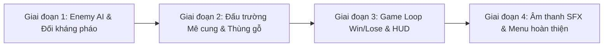

# 🗺️ TANK ARTILLERY ARENA — LỘ TRÌNH 4 GIAI ĐOẠN HOÀN THIỆN GAME
> **Mục tiêu:** Chuyển đổi prototype cơ chế thành một tựa game hoàn chỉnh có vòng lặp gameplay (Core Loop), trí tuệ nhân tạo đối kháng, bản đồ chiến thuật và điều kiện Thắng/Thua.

---

## 📑 MỤC LỤC
1. [Tổng Quan Tiến Trình (High-Level Overview)](#1-tổng-quan-tiến-trình)
2. [Giai Đoạn 1: Trí Tuệ Nhân Tạo & Kẻ Địch Chiến Thuật (Enemy AI)](#giai-đoạn-1-trí-tuệ-nhân-tạo--kẻ-địch-chiến-thuật)
3. [Giai Đoạn 2: Đấu Trường Mê Cung & Vật Cản Phá Hủy (Arena & Destructibles)](#giai-đoạn-2-đấu-trường-mê-cung--vật-cản-phá-hủy)
4. [Giai Đoạn 3: Vòng Lặp Trận Đấu & Hệ Thống Thắng/Thua (Game Loop)](#giai-đoạn-3-vòng-lặp-trận-đấu--hệ-thống-thắngthua)
5. [Giai Đoạn 4: Âm Thanh SFX, Đánh Bóng & Menu Hoàn Thiện (Audio & Juice)](#giai-đoạn-4-âm-thanh-sfx-đánh-bóng--menu-hoàn-thiện)

---

## 1. TỔNG QUAN TIẾN TRÌNH

| Giai đoạn | Trọng tâm | Sản phẩm đầu ra | Tiêu chí hoàn thành |
| :--- | :--- | :--- | :--- |
| **Giai đoạn 1** | Enemy AI & Combat | `EnemyTank.tscn`, `EnemyAI.gd`, `EnemyBullet.tscn`, `HealthBar.tscn` | AI biết núp tường nã pháo gián tiếp, xả súng máy khi lộ diện, lùi xe khi bị áp sát |
| **Giai đoạn 2** | Mê cung & Hồi máu | `ArenaMap.tscn`, `Crate.tscn`, `HealthPickup.tscn` | Bản đồ khép kín có các ụ tường chữ L/U; bắn vỡ thùng nhặt hộp cứu thương |
| **Giai đoạn 3** | Vòng lặp Game | `GameManager.gd`, `VictoryScreen.tscn`, `GameOverScreen.tscn` | Tiêu diệt hết địch = Thắng; Hết máu = Thua; Bấm nút Chơi lại chuyển màn mượt mà |
| **Giai đoạn 4** | Âm thanh & Polish | `AudioManager.gd`, `SFX`, `MainMenu.tscn`, `TreadMarks` | Tiếng pháo gầm, súng máy, nổ xe; vệt xích xe; màn hình Menu chính |

---

## GIAI ĐOẠN 1: TRÍ TUỆ NHÂN TẠO & KẺ ĐỊCH CHIẾN THUẬT

### 🎯 Mục tiêu
Biến bia tập bắn tĩnh thành xe tăng địch đối kháng thực thụ, biết suy nghĩ chiến thuật: nã pháo cầu vồng qua chướng ngại vật khi không có góc bắn thẳng.

### 📋 Hạng mục kỹ thuật
- [ ] **Thực thể Xe tăng địch (`EnemyTank.tscn`):**
  - Layer 3 (`Enemy`), Mask va chạm với Tường (1), Xe người chơi (2), Đạn người chơi (4), Nổ AoE (7).
  - Sprite thân xe đỏ/đen + tháp pháo riêng biệt.
  - Thanh máu đồ họa `HealthBar` nổi trên nóc xe hiển thị trực quan theo thời gian thực.
- [ ] **Bộ não AI (`EnemyAI.gd` - Máy trạng thái FSM):**
  - **Tầm nhìn `RayCast2D`:** Bắn tia kiểm tra vật cản giữa AI và Player.
  - **Trạng thái 1: Nã Pháo Gián Tiếp (Indirect Artillery):** Khi có tường chắn chắn giữa 2 xe $\rightarrow$ AI tự đo cự ly $D$, xoay tháp pháo và nã pháo Parabola cầu vồng vọt qua tường đón đầu vị trí người chơi!
  - **Trạng thái 2: Giao chiến tầm gần (Direct Combat):** Khi người chơi rời khỏi tường che $\rightarrow$ AI chuyển sang xả súng máy liên thanh.
  - **Trạng thái 3: De xe giữ khoảng cách (Kiting):** Khi người chơi lao vào cự ly tử địa ($< 180\text{px}$) $\rightarrow$ AI vừa lùi xe ra xa vừa xả đạn phòng thủ.
- [ ] **Đạn súng máy của địch (`EnemyMachineGunBullet.tscn`):**
  - Layer 5 (`EnemyBullet`), Mask va chạm với Tường (1) và Người chơi (2).

---

## GIAI ĐOẠN 2: ĐẤU TRƯỜNG MÊ CUNG & VẬT CẢN PHÁ HỦY

### 🎯 Mục tiêu
Tạo không gian tác chiến hoàn chỉnh, có chiến thuật ẩn nấp và tài nguyên hồi phục sinh tồn.

### 📋 Hạng mục kỹ thuật
- [ ] **Bản đồ Đấu trường khép kín (`ArenaMap.tscn`):**
  - Kích thước chuẩn $2400 \times 1600\text{ px}$.
  - Tường biên bao quanh (Outer Boundary) chống rơi xe ra ngoài.
  - Các ụ tường hình chữ L, chữ U, ngõ hẹp chia sân đấu thành các khu vực đấu pháo chiến thuật.
- [ ] **Thùng gỗ phá hủy được (`DestructibleCrate.tscn`):**
  - Máu: 25 HP. Khi dính đạn pháo hoặc súng máy sẽ vỡ vụn kèm hiệu ứng mảnh gỗ văng.
  - Tỉ lệ rơi vật phẩm: 40% rơi ra Hộp cứu thương.
- [ ] **Hộp cứu thương (`HealthPickup.tscn`):**
  - Người chơi lái xe đè qua sẽ được hồi +35 HP, phát hiệu ứng hồi máu xanh lá.

---

## GIAI ĐOẠN 3: VÒNG LẶP TRẬN ĐẤU & HỆ THỐNG THẮNG/THUA

### 🎯 Mục tiêu
Xây dựng vòng lặp trò chơi hoàn chỉnh: Bắt đầu $\rightarrow$ Chiến đấu $\rightarrow$ Kết thúc có kết quả $\rightarrow$ Chơi lại.

### 📋 Hạng mục kỹ thuật
- [ ] **Hệ thống Quản lý Trận đấu (`GameManager.gd`):**
  - Theo dõi danh sách xe địch còn sống.
  - Khi xe địch bị tiêu diệt: Giảm đếm số quái, phát tín hiệu `enemy_count_changed`.
- [ ] **Điều kiện Thắng / Thua (Win/Loss System):**
  - **VICTORY:** Khi diệt sạch toàn bộ xe địch $\rightarrow$ Mở bảng `VictoryScreen.tscn` (thống kê thời gian, điểm, nút Chơi lại).
  - **GAME OVER:** Khi xe người chơi hết máu $\rightarrow$ Mở bảng `GameOverScreen.tscn` (nút Thử lại).
- [ ] **Nâng cấp HUD:**
  - Thanh máu người chơi dạng Slider lớn góc dưới.
  - Bộ đếm: `Kẻ địch còn lại: X / Y`.
  - Mũi tên chỉ thị ngoài màn hình (Off-screen Indicator) định vị xe địch ở xa.

---

## GIAI ĐOẠN 4: ÂM THANH SFX, ĐÁNH BÓNG & MENU HOÀN THIỆN

### 🎯 Mục tiêu
Nâng tầm trải nghiệm thị giác và thính giác, đóng gói sản phẩm hoàn chỉnh để nộp đồ án.

### 📋 Hạng mục kỹ thuật
- [ ] **Hệ thống Âm thanh SFX (`AudioManager.gd`):**
  - Tiếng pháo cối khai hỏa trầm vang (`Heavy Cannon Boom`).
  - Tiếng súng máy đanh gọn (`MG Rapid Fire`).
  - Tiếng động cơ gầm gừ theo vận tốc xe.
  - Tiếng xích xe nghiến trên nền đất.
  - Tiếng nổ tung xác xe (`Tank Destruction`).
- [ ] **Hiệu ứng Vệt Xích Xe (`TreadMarks`):**
  - Vẽ vết xích đen mờ trên mặt đất mỗi khi xe xoay hoặc tiến lùi.
- [ ] **Menu Chính (`MainMenu.tscn`):**
  - Nút *Bắt đầu chiến dịch*, *Hướng dẫn phím*, *Thoát game*.
