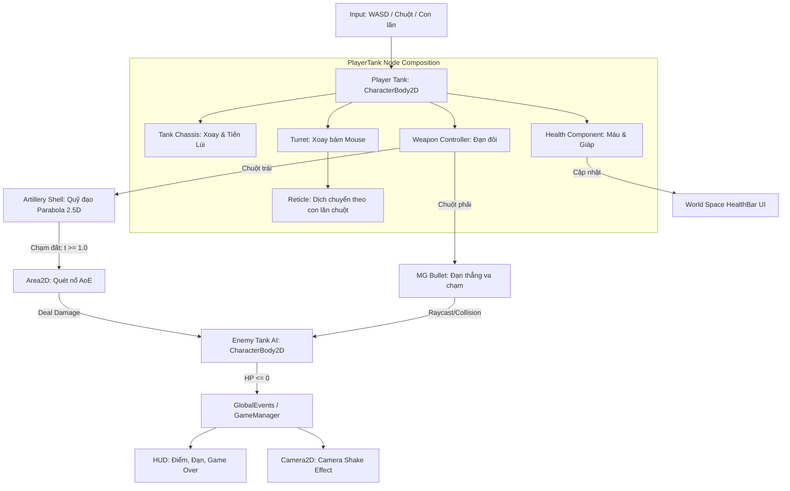
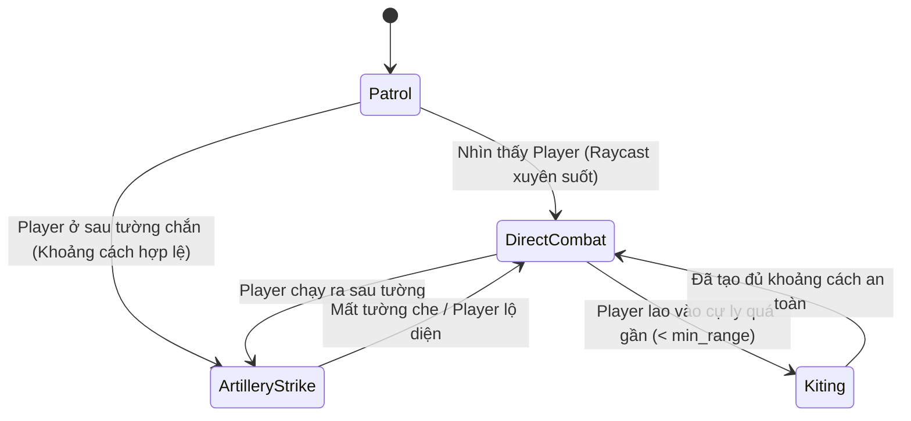

# 🛡️ TANK ARTILLERY ARENA — THIẾT KẾ HỆ THỐNG (GODOT 4 EDITION)
> **Dự án:** Tank Artillery Arena  
> **Engine:** Godot 4.x (GDScript) | **Độ phân giải:** 1920x1080 (Viewport Mode: canvas_items, Aspect: keep)  
> **Tài liệu tham chiếu:** [`TANK_ARTILLERY_ARENA_PLAN.md`](file:///d:/Do%20an%202026/MTA/Plan/TANK_ARTILLERY_ARENA_PLAN.md)

---

## 📑 MỤC LỤC
1. [Tổng Quan Kiến Trúc Hệ Thống (System Architecture)](#1-tổng-quan-kiến-trúc-hệ-thống)
2. [Cấu Trúc Thư Mục Dự Án (Project Folder Structure)](#2-cấu-trúc-thư-mục-dự-án)
3. [Phân Tầng Vật Lý & Ma Trận Va Chạm (Physics Layers)](#3-phân-tầng-vật-lý--ma-trận-va-chạm)
4. [Sơ Đồ Phân Rã Node & Scene (Scene & Node Tree)](#4-sơ-đồ-phân-rã-node--scene)
5. [Giải Thuật Cốt Lõi: Đạn Parabola 2.5D & Con Lăn Chuột](#5-giải-thuật-cốt-lõi-đạn-parabola-25d--con-lăn-chuột)
6. [Đặc Tả Chi Tiết Các Lớp GDScript](#6-đặc-tả-chi-tiết-các-lớp-gdscript)
7. [Hệ Thống Trí Tuệ Nhân Tạo (Enemy AI FSM)](#7-hệ-thống-trí-tuệ-nhân-tạo)
8. [Phân Định Nhiệm Vụ: Antigravity Assistant & Người Dùng](#8-phân-định-nhiệm-vụ)

---

## 1. TỔNG QUAN KIẾN TRÚC HỆ THỐNG

Khác với kiến trúc Component-based của Unity (`MonoBehaviour`), Godot 4 tổ chức hệ thống theo mô hình **Node Tree** kết hợp **Composition**:
* **Thực thể Xe Tăng (`CharacterBody2D`):** Sử dụng các node con chuyên biệt:
  * `TankChassis`: Xử lý di chuyển tiến/lùi và xoay góc bánh xích.
  * `TurretController`: Xử lý nòng xoay độc lập theo con trỏ chuột và hồng tâm Reticle.
  * `WeaponController`: Quản lý 2 cơ chế bắn (Pháo cối Parabola & Súng máy).
  * `HealthComponent`: Quản lý máu, nhận sát thương và phát tín hiệu `health_changed`, `died`.
* **Cơ chế Event-Driven (Tín hiệu - Signals):**
  * Sử dụng hệ thống **Signals** bản địa của Godot để giao tiếp giữa các thành phần (vd: `WeaponController` phát tín hiệu bắn $\rightarrow$ sinh đạn vào Root Scene).
  * Sử dụng Singleton (Autoload) `GlobalEvents.gd` để quản lý các sự kiện toàn cục: điểm số, camera shake, trạng thái thắng/thua.



---

## 2. CẤU TRÚC THƯ MỤC DỰ ÁN

Dự án Godot sẽ được tạo tại đường dẫn: `d:/Do an 2026/MTA/Godot/TankArtilleryArena/`

```text
res://
├── project.godot               # Cấu hình chính của Godot (Input map, layers, resolution)
├── assets/                     # Tài nguyên gốc
│   ├── sprites/
│   │   ├── tanks/             # Thân xe, tháp pháo, nòng, xích xe (Kenney)
│   │   ├── environment/       # Tường gạch, bao cát, mặt đất bê tông
│   │   ├── projectiles/       # Đạn pháo, bóng đạn, đạn súng máy
│   │   └── ui/                # Hồng tâm Reticle, icons, khung UI
│   ├── audio/
│   │   ├── sfx/               # Tiếng gầm pháo, súng máy, tiếng nổ, động cơ
│   │   └── bgm/               # Nhạc nền chiến đấu
│   └── fonts/                 # Phông chữ giao diện
├── scenes/                     # Các Scene (.tscn)
│   ├── main/
│   │   ├── Main.tscn          # Scene màn chơi chính (Đấu trường Mê cung)
│   │   └── MainMenu.tscn      # Menu bắt đầu
│   ├── entities/
│   │   ├── PlayerTank.tscn    # Xe tăng người chơi
│   │   └── EnemyTank.tscn     # Xe tăng AI (Easy / Hard)
│   ├── weapons/
│   │   ├── ArtilleryShell.tscn # Đạn pháo cối cầu vồng
│   │   └── MachineGunBullet.tscn # Đạn súng máy
│   ├── vfx/
│   │   ├── ExplosionVFX.tscn  # Hiệu ứng nổ hạt & khói
│   │   └── DustTrail.tscn     # Bụi xích xe
│   └── ui/
│       ├── HUD.tscn           # Giao diện nạp đạn, radar, điểm
│       └── HealthBar.tscn     # Thanh máu trôi trên nóc xe
└── scripts/                    # Toàn bộ mã nguồn (.gd)
    ├── autoload/
    │   ├── GlobalEvents.gd    # Event Bus toàn cục
    │   └── GameManager.gd     # Quản lý vòng lặp game, điểm số
    ├── entities/
    │   ├── TankChassis.gd     # Vật lý lái xe
    │   ├── TurretAim.gd       # Xoay tháp pháo & lăn chuột
    │   ├── WeaponController.gd # Xử lý 2 loại vũ khí
    │   └── HealthComponent.gd # Nhận sát thương, hồi máu
    ├── weapons/
    │   ├── ArtilleryShell.gd  # Toán học Parabola & kích nổ
    │   └── MachineGunBullet.gd# Đạn thẳng
    ├── ai/
    │   └── EnemyAI.gd         # Trí tuệ nhân tạo (Kite, nã pháo qua tường)
    └── vfx/
        └── CameraShake.gd     # Rung màn hình khi có chấn động
```

---

## 3. PHÂN TẦNG VẬT LÝ & MA TRẬN VA CHẠM

Godot 4 hỗ trợ 32 Physics Layers 2D. Cấu hình phân tầng như sau:

| Layer # | Tên Layer (2D Physics) | Vai trò | Va chạm với (Mask) |
| :---: | :--- | :--- | :--- |
| **1** | `Obstacle` (Tường mê cung) | Tường gạch, vật cản cứng | Player, Enemy, MGBullet |
| **2** | `Player` | Xe tăng người chơi | Obstacle, Enemy, EnemyMGBullet, ExplosionAoE |
| **3** | `Enemy` | Xe tăng địch (AI) | Obstacle, Player, PlayerMGBullet, ExplosionAoE |
| **4** | `PlayerBullet` | Đạn súng máy người chơi | Obstacle, Enemy |
| **5** | `EnemyBullet` | Đạn súng máy của địch | Obstacle, Player |
| **6** | `ArtilleryShell` | Đạn pháo đang bay trên không | **Không va chạm với Layer nào (Mask = 0)** |
| **7** | `ExplosionAoE` | Vụ nổ khi đạn pháo chạm đất | Player, Enemy (tùy thuộc phe bắn) |

> 💡 **Điểm mấu chốt:** Layer 6 (`ArtilleryShell`) hoàn toàn không có Mask va chạm trong suốt thời gian bay ($0 < t < 1$). Nhờ đó đạn bay vọt qua mọi bức tường của Layer 1 mà không bị chặn lại.

---

## 4. SƠ ĐỒ PHÂN RÃ NODE & SCENE

### 4.1. Scene `PlayerTank.tscn`
```text
PlayerTank (CharacterBody2D) - Script: TankChassis.gd
├── CollisionShape2D (RectangleShape2D - Khung va chạm thân xe)
├── ChassisSprite (Sprite2D - Thân xe tăng)
├── TracksParticles (CPUParticles2D - Vết xích & khói bụi)
├── Turret (Node2D) - Script: TurretAim.gd
│   ├── TurretSprite (Sprite2D - Nòng và tháp pháo)
│   ├── ArtilleryMuzzle (Marker2D - Điểm thoát đạn pháo)
│   ├── MGMuzzle (Marker2D - Điểm thoát đạn súng máy)
│   └── Reticle (Node2D) - Vị trí cự ly ngắm pháo
│       └── ReticleSprite (Sprite2D - Vòng tròn hồng tâm)
├── WeaponController (Node) - Script: WeaponController.gd
├── HealthComponent (Node) - Script: HealthComponent.gd
└── FloatingUI (Node2D)
    └── HealthBar (ProgressBar / TextureProgressBar)
```

### 4.2. Scene `ArtilleryShell.tscn` (Mô hình 2.5D)
```text
ArtilleryShell (Node2D) - Script: ArtilleryShell.gd
├── ShadowSprite (Sprite2D - Elip đen mờ, chạy bám sát mặt đất)
├── ShellVisual (Sprite2D - Hình viên đạn, bay bổng theo Parabola trục Y)
└── ExplosionArea (Area2D) - Tắt mặc định, chỉ bật 1 frame khi t >= 1.0
    └── CollisionShape2D (CircleShape2D - Bán kính nổ AoE)
```

---

## 5. GIẢI THUẬT CỐT LÕI: ĐẠN PARABOLA 2.5D & CON LĂN CHUỘT

### 5.1. Con lăn chuột điều chỉnh cự ly ngắm (Elevation Control)
Trong `TurretAim.gd`:
* Nòng pháo luôn quay góc mặt về phía chuột:  
  `turret.look_at(get_global_mouse_position())`
* Con lăn chuột dịch chuyển khoảng cách cự ly `current_elevation`:
  ```gdscript
  func _unhandled_input(event: InputEvent) -> void:
      if event is InputEventMouseButton:
          if event.button_index == MOUSE_BUTTON_WHEEL_UP:
              current_elevation = clamp(current_elevation + scroll_step, min_range, max_range)
          elif event.button_index == MOUSE_BUTTON_WHEEL_DOWN:
              current_elevation = clamp(current_elevation - scroll_step, min_range, max_range)
  ```
* Tọa độ mục tiêu Reticle trên mặt phẳng đất:  
  $P_1 = P_{turret} + \vec{u}_{turret} \times \text{current\_elevation}$

### 5.2. Chuyển động Parabola 2.5D trong không gian 2D
Trong `ArtilleryShell.gd`:
* Gọi $P_0$ là tọa độ bắn, $P_1$ là tọa độ mục tiêu (Reticle).
* Khoảng cách $D = \|P_1 - P_0\|$, thời gian bay $T = \frac{D}{V_{horizontal}}$.
* Chuẩn hóa thời gian $t = \frac{\text{elapsed}}{T} \in [0, 1]$.
* Tọa độ mặt đất phẳng:
  $$P_{ground}(t) = \text{lerp}(P_0, P_1, t)$$
* Độ cao không gian giả lập (Hàm bậc hai đối xứng):
  $$H(t) = 4 \times H_{max} \times t \times (1 - t)$$
  *(Với $H_{max} = D \times 0.35$)*
* **Render trên màn hình:**
  * `ShadowSprite.global_position = P_ground(t)`
  * `ShellVisual.global_position = P_ground(t) - Vector2(0, H(t))` *(Trục Y âm hướng lên trên trong Godot 2D)*
  * Thu phóng tỉ lệ: `ShellVisual.scale = Vector2.ONE * (1.0 + (H(t) / H_max) * 0.4)`

---

## 6. ĐẶC TẢ CHI TIẾT CÁC LỚP GDSCRIPT

### 6.1. `TankChassis.gd`
* **Nhiệm vụ:** Xử lý lái xe tăng bằng vật lý `CharacterBody2D`.
* **Biến số:**
  * `move_speed: float = 180.0` (Tốc độ tiến/lùi pixel/s)
  * `rotation_speed: float = 2.8` (Tốc độ xoay rad/s)
* **Phương thức:**
  * `_physics_process(delta)`:
    * Đọc `Input.get_axis("turn_left", "turn_right")` $\rightarrow$ xoay thân xe `rotation += steer * rotation_speed * delta`.
    * Đọc `Input.get_axis("move_down", "move_up")` $\rightarrow$ tính `velocity = transform.x * throttle * move_speed`.
    * Gọi `move_and_slide()` để tự động trượt mượt mà dọc theo tường mê cung.

### 6.2. `TurretAim.gd`
* **Nhiệm vụ:** Xoay tháp pháo mượt mà hướng về con trỏ chuột, cập nhật vị trí Reticle.
* **Biến số:**
  * `turret_rotation_speed: float = 5.0`
  * `current_elevation: float = 350.0`
  * `min_range: float = 120.0`, `max_range: float = 800.0`
* **Phương thức:**
  * Cập nhật góc quay: dùng `rotate_toward()` để nòng pháo xoay có độ trễ cơ học chân thực.
  * Cập nhật vị trí `ReticleNode.global_position`.

### 6.3. `WeaponController.gd`
* **Nhiệm vụ:** Điều phối 2 loại vũ khí:
  * **Chuột trái:** Bắn pháo cối. Sinh instance `ArtilleryShell.tscn`, truyền $(P_0, P_1)$, kích hoạt thời gian hồi nạp (Reload Cooldown: 2.5s).
  * **Chuột phải:** Bắn súng máy liên thanh (Fire rate: 0.1s). Sinh đạn thẳng `MachineGunBullet.tscn`.
* **Tín hiệu:** `artillery_fired`, `mg_fired`, `reloading_progress(ratio)`.

### 6.4. `HealthComponent.gd`
* **Nhiệm vụ:** Quản lý máu `max_hp = 100`, `current_hp`.
* **Phương thức:**
  * `take_damage(amount: int, is_aoe: bool)`: Trừ máu, nháy sprite đỏ, phát tín hiệu `health_changed`.
  * Nếu `current_hp <= 0` $\rightarrow$ phát tín hiệu `died` $\rightarrow$ sinh vụ nổ nát xe và phát thông báo tới `GameManager`.

---

## 7. HỆ THỐNG TRÍ TUỆ NHÂN TẠO (ENEMY AI FSM)

Xe tăng máy (Enemy AI) có 2 cấp độ được điều khiển bởi `EnemyAI.gd`:



1. **Kiểm tra vật cản (`RayCast2D`):**
   * AI liên tục bắn 1 tia RayCast từ tháp pháo tới Player.
   * Nếu tia **không chạm tường**: AI dùng súng máy và pháo thẳng áp đảo (`DirectCombat`).
2. **Chiến thuật nã pháo gián tiếp (`ArtilleryStrike`):**
   * Nếu tia **bị tường che khuất**: AI tự động đo khoảng cách $D = \text{distance\_to(Player)}$, đặt `current_elevation = D`, xoay nòng về hướng Player và khai hỏa pháo cầu vồng vọt qua tường!
3. **Thao tác lùi xe giữ cự ly (`Kiting`):**
   * Khi Player tiến quá sát ($D < 120\text{px}$), AI tự động đảo số lùi xe, vừa lùi vừa xả súng máy.

---

## 8. PHÂN ĐỊNH NHIỆM VỤ: ANTIGRAVITY ASSISTANT & NGƯỜI DÙNG

Để bạn nắm rõ khi nào cần báo tôi làm và khi nào bạn cần thao tác:

### 🤖 Những gì Antigravity có thể làm tự động 100%:
1. **Khởi tạo & cấu hình dự án Godot:** Tạo file `project.godot`, cấu hình độ phân giải 1920x1080, cài đặt Input Map (phím điều khiển, chuột, lăn chuột), cài đặt 32 Physics Layers.
2. **Viết toàn bộ mã nguồn GDScript:** Lập trình chuyển động xe, công thức Parabola, hệ thống vũ khí kép, máu, điểm số, AI xe tăng.
3. **Dựng các Scene (.tscn) dạng văn bản:** Tạo cấu trúc cây Node cho xe tăng người chơi, xe địch, đạn pháo, đạn súng máy, thanh máu, camera shake.
4. **Tải & sắp xếp thư mục Asset:** Tự động tạo thư mục, sắp đặt sprite xe tăng, gạch ngói, âm thanh SFX vào đúng vị trí `res://assets/`.
5. **Chạy kiểm tra dự án bằng lệnh console:** Dùng `Godot_v4.7.2-stable_win64_console.exe` để biên dịch thử, kiểm tra lỗi cú pháp GDScript headless không cần mở UI.

### 👤 Những gì bạn (Người dùng) làm trên Editor trực quan:
1. **Mở Godot Engine:** Nhấp đúp vào [`Godot_v4.7.2-stable_win64.exe`](file:///d:/Do%20an%202026/MTA/Godot/Engine/Godot_v4.7.2-stable_win64.exe) và mở project từ thư mục để xem giao diện trực quan.
2. **Tự tay vẽ/chỉnh sửa TileMap Mê cung (nếu muốn):** Dùng công cụ cọ vẽ TileMap của Godot để tạo ra các mê cung chiến thuật theo ý thích.
3. **Bấm F5 để Test Game:** Trải nghiệm trực tiếp cảm giác lăn chuột chỉnh cự ly, bắn pháo gián tiếp qua tường và đấu trí cùng AI.
