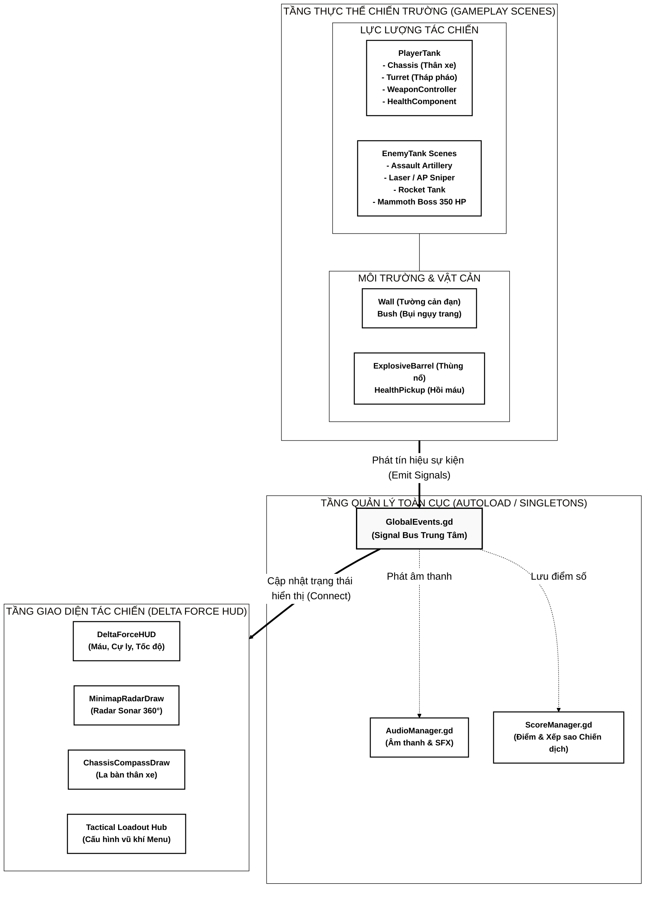
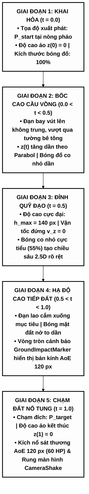
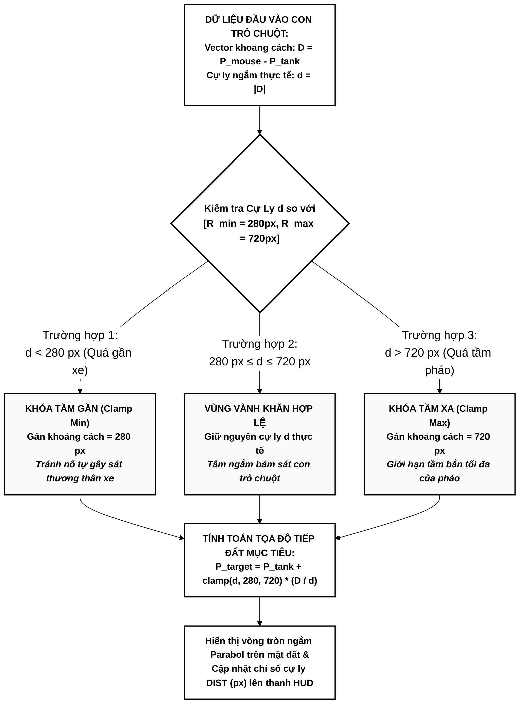
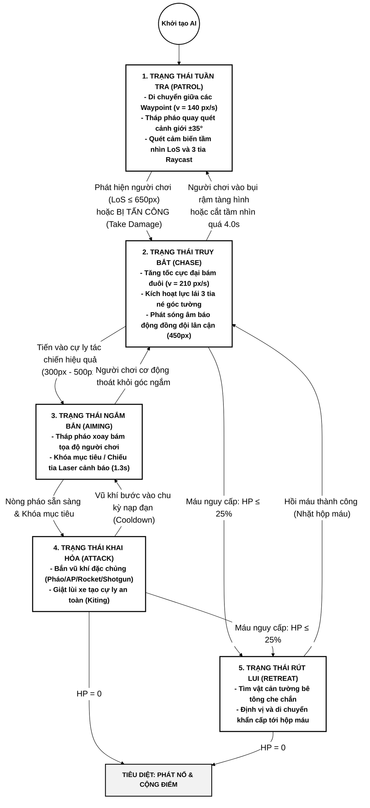
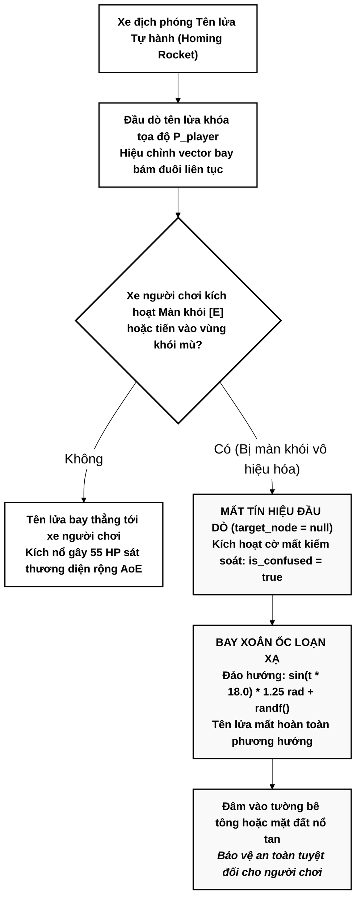

# TỔNG HỢP MÃ SƠ ĐỒ MERMAID CHUẨN HÓA IN ẤN & TỐI ƯU KHỔ WORD A4
> **Đồ án:** Nghiên Cứu Công Nghệ Game Engine và Phát Triển Game Chiến Thuật Pháo Binh 2.5D (Dự án: Tank Artillery Arena)  
> **Tài liệu tham chiếu:** `docs/BAO_CAO_DO_AN_TANK_ARTILLERY_ARENA.md`  
> **Mục đích tài liệu:** Cung cấp mã nguồn Mermaid đã chuẩn hóa toàn bộ về phong cách đồ họa tương phản cao trên nền trắng (High-Contrast Monochrome / Technical Blueprint), kích thước phông chữ lớn (18px - 22px), nét vẽ đậm (2px) và bố cục kiểm soát chặt chẽ chiều rộng để khi dán vào Microsoft Word khổ giấy A4 không bị tràn lề, không bị thu nhỏ làm mờ chữ.

---

## PHẦN 1. BẢNG PHÂN LOẠI TOÀN BỘ HÌNH ẢNH TRONG BÁO CÁO

Trong báo cáo đồ án gồm tổng cộng **14 hình ảnh**, được phân chia rành mạch thành 2 nhóm:

| Số hiệu Hình | Tên hình ảnh trong Báo cáo | Phân loại | Phương thức thực hiện |
| :---: | :--- | :---: | :--- |
| **Hình 2.1** | Sơ đồ Kiến trúc Tổng thể Hệ thống Scene-Node & Signal Bus | **Sơ đồ Kỹ thuật** | **Mã Mermaid (Sơ đồ 1 bên dưới)** |
| **Hình 2.2** | Mô hình Quỹ đạo Đạn Parabola 2.5D và Độ cao ảo $z(t)$ | **Sơ đồ Thuật toán** | **Mã Mermaid (Sơ đồ 2 bên dưới)** |
| **Hình 2.3** | Sơ đồ Thuật toán Khóa Cự ly Ngắm Vành khăn (Annulus Aim Clamp) | **Sơ đồ Thuật toán** | **Mã Mermaid (Sơ đồ 3 bên dưới)** |
| **Hình 2.4** | Mô hình Máy Trạng thái Hữu hạn AI Xe Tăng Địch (AI FSM) | **Sơ đồ Trạng thái** | **Mã Mermaid (Sơ đồ 4 bên dưới)** |
| **Hình 3.1** | Mô hình Thân xe Độc lập với Tháp pháo và Chỉ báo Neon Chevrons | Ảnh chụp thực tế | Chụp trong game (`hinh_3_1_than_xe_chassis.png`) |
| **Hình 3.2** | Bố cục Cửa sổ Tùy chỉnh Hỏa lực Chiến Tăng (Tactical Loadout Modal) | Ảnh chụp thực tế | Chụp trong game (`hinh_3_2_modal_loadout.png`) |
| **Hình 3.3** | Chu trình Súng máy Tăng tốc (Spool-Up) và Quá nhiệt Nòng súng | **Sơ đồ Giải thuật** | **Mã Mermaid (Sơ đồ 5 bên dưới)** |
| **Hình 3.4** | Cơ chế Màn khói Tác chiến Điện tử làm Nhiễu loạn Tên lửa | **Sơ đồ Giải thuật** | **Mã Mermaid (Sơ đồ 6 bên dưới)** |
| **Hình 3.5** | Bố cục Giao diện Quân sự Tối giản (Delta Force HUD) & Camera Zoom | Ảnh chụp thực tế | Chụp trong game (`hinh_3_5_delta_force_hud.png`) |
| **Hình 4.1** | Bản đồ Chiến thuật 10 Màn chơi Chiến dịch và Phòng tập Sandbox | Ảnh chụp thực tế | Chụp trong game (`hinh_4_1_bando_10_man_choi.png`) |
| **Hình 4.2** | Giao diện Menu Chính và Cửa sổ Lựa chọn Trang bị Hỏa lực | Ảnh chụp thực tế | Chụp trong game (`hinh_4_2_menu_chinh_loadout.png`) |
| **Hình 4.3** | Trận địa Mở rộng với Góc nhìn Camera Zoom 0.65 và Minimap Radar | Ảnh chụp thực tế | Chụp trong game (`hinh_4_3_camera_zoom_radar.png`) |
| **Hình 4.4** | Đại chiến Siêu Xe Tăng Trùm Cuối Mammoth Boss tại Màn 10 | Ảnh chụp thực tế | Chụp trong game (`hinh_4_4_boss_mammoth_man_10.png`) |
| **Hình 4.5** | Màn hình Chiến thắng Tổng kết Thời gian, Điểm số và 5 Sao Max Cấp | Ảnh chụp thực tế | Chụp trong game (`hinh_4_5_man_hinh_chien_thang.png`) |

---

## PHẦN 2. MÃ NGUỒN 6 SƠ ĐỒ MERMAID CHUẨN HÓA CHO BẢN IN WORD

### 1. Sơ đồ 1 — Hình 2.1: Kiến trúc Phân tầng Hệ thống (Mục 2.1)
- **Vị trí trong báo cáo:** Chương 2, Mục 2.1 (Trang 18 - 20).
- **Tối ưu khổ Word:** Xếp theo chiều dọc (`flowchart TD`), nhóm các thành phần Player, Enemy, Environment theo 2 cột cân đối thay vì trải dài 3 cột ngang, giữ cho chiều rộng sơ đồ không vượt quá 850px (vừa khít 16cm lề trang Word A4 dọc).

---

### 2. Sơ đồ 2 — Hình 2.2: Tiến trình Quỹ đạo Đạn Parabol 2.5D (Mục 2.3.1)
- **Vị trí trong báo cáo:** Chương 2, Mục 2.3.1 (Trang 23 - 25).
- **Tối ưu khổ Word:** Chuyển từ dàn ngang 5 khối (`flowchart LR` gây tràn lề) sang dạng tiến trình dọc từng bước (`flowchart TD`). Chiều rộng cực kỳ nhỏ gọn (~480px), đọc cực rõ nét ở trang in Word A4.

---

### 3. Sơ đồ 3 — Hình 2.3: Giải thuật Khóa Phạm vi Ngắm Vành khăn (Mục 2.3.2)
- **Vị trí trong báo cáo:** Chương 2, Mục 2.3.2 (Trang 26 - 27).
- **Tối ưu khổ Word:** Giữ cấu trúc 3 nhánh rẽ nhưng ngắt dòng súc tích, chữ đen nền trắng viền đen 2px, nhãn điều kiện rõ ràng.

---

### 4. Sơ đồ 4 — Hình 2.4: Máy Trạng thái Hữu hạn AI Xe Tăng Địch (Mục 2.3.4)
- **Vị trí trong báo cáo:** Chương 2, Mục 2.3.4 (Trang 29 - 31).
- **Tối ưu khổ Word:** Chuẩn hóa sang dạng lưu đồ trạng thái tuần tự rõ ràng (Flowchart State Machine), triệt tiêu các lỗi font của `stateDiagram-v2`, hiển thị trực quan 5 trạng thái với cỡ chữ 16px - 18px in đậm nền trắng.

---

### 5. Sơ đồ 5 — Hình 3.3: Chu trình Súng máy Tăng tốc & Quá nhiệt (Mục 3.2.3)
- **Vị trí trong báo cáo:** Chương 3, Mục 3.2.3 (Trang 38 - 40).
- **Tối ưu khổ Word:** Chuẩn hóa mã nguồn theo đúng mẫu tham chiếu của người dùng: nền trắng, viền đen 2px, cỡ chữ lớn 18px - 22px in đậm, chuyển ký tự mũi tên thành `->` chống lỗi hiển thị.

```mermaid
%%{init: {'theme': 'base', 'themeVariables': { 'clusterBkg': '#ffffff', 'clusterBorder': '#000000', 'lineColor': '#000000', 'edgeLabelBackground':'#ffffff', 'primaryTextColor': '#000000', 'fontSize': '22px'}}}%%
flowchart LR
    classDef default fill:#ffffff,stroke:#000000,stroke-width:2px,color:#000000,font-size:18px,font-weight:bold;

    subgraph S_IDLE["1. TRẠNG THÁI NGHỈ (IDLE)"]
        direction TB
        I1["Nòng súng nguội: Heat = 0%"]
        I2["Tốc độ bắn ban đầu: 0.16s / viên"]
    end

    subgraph S_FIRE["2. GIỮ CHUỘT PHẢI: TĂNG TỐC (SPOOL-UP)"]
        direction TB
        F1["Nòng xoay tăng tốc: spool_progress -> 1.0"]
        F2["Tốc độ xả đạn cực đại: 0.045s / viên (x3.5)"]
        F3["Nhiệt lượng tích tụ: +6.5% / mỗi viên"]
    end

    subgraph S_OVERHEAT["3. ĐẠT 100% NHIỆT: QUÁ NHIỆT (BURN OUT)"]
        direction TB
        O1["Khóa nòng súng hoàn toàn trong 2.8s"]
        O2["Cảnh báo [OVERHEATED] nhấp nháy đỏ trên HUD"]
        O3["Không thể khai hỏa cho đến khi hạ nhiệt"]
    end

    subgraph S_COOL["4. HẠ NHIỆT TỰ NHIÊN (COOLDOWN)"]
        direction TB
        C1["Nhả chuột: Hạ nhiệt độ -35% / giây"]
        C2["Về trạng thái an toàn: Heat = 0%"]
    end

    S_IDLE -- "Nhấn giữ Chuột Phải" --> S_FIRE
    S_FIRE -- "Nhả chuột khi Heat &lt; 100%" --> S_COOL
    S_FIRE -- "Giữ bắn liên tục tới Heat = 100%" --> S_OVERHEAT
    S_OVERHEAT -- "Hết thời gian cưỡng chế 2.8s" --> S_IDLE
    S_COOL --> S_IDLE
```

---

### 6. Sơ đồ 6 — Hình 3.4: Giải thuật Màn khói Tác chiến Điện tử (Mục 3.4.3)
- **Vị trí trong báo cáo:** Chương 3, Mục 3.4.3 (Trang 48 - 49).
- **Tối ưu khổ Word:** Bố cục dạng phân nhánh điều kiện dọc, nền trắng viền đen 2px, kích thước nhỏ gọn (~540px), chữ to 18px dễ đọc.

---

## PHẦN 3. HƯỚNG DẪN ĐƯA VÀO FILE MICROSOFT WORD IN ẤN

1. **Cách 1 — Chèn trực tiếp qua tiện ích Markdown trong VSCode / Typora:**
   - Khi mở tệp báo cáo bằng phần mềm soạn thảo hỗ trợ Mermaid (Typora, Obsidian, VSCode Preview Enhanced), toàn bộ 6 sơ đồ trên sẽ tự động kết xuất thành hình vẽ vector nền trắng, viền đen sắc nét, cỡ chữ lớn 18px - 22px.
   - Nhấn `Ctrl + A` $\rightarrow$ `Ctrl + C` và dán thẳng vào Microsoft Word, sơ đồ sẽ giữ nguyên tỷ lệ trang in A4 chuẩn.

2. **Cách 2 — Sao chép ảnh SVG/PNG từ trình duyệt:**
   - Mở trình soạn thảo Markdown Preview, nhấp chuột phải vào từng sơ đồ chọn **Copy Image** rồi `Ctrl + V` vào Word.
   - Do đã được giới hạn chiều rộng và đặt phông chữ `18px - 22px`, hình ảnh khi chèn vào trang giấy A4 Word sẽ vừa vặn tuyệt đối từ lề trái (3cm) đến lề phải (2cm), không bị co cụm chữ và không bị tràn trang.

